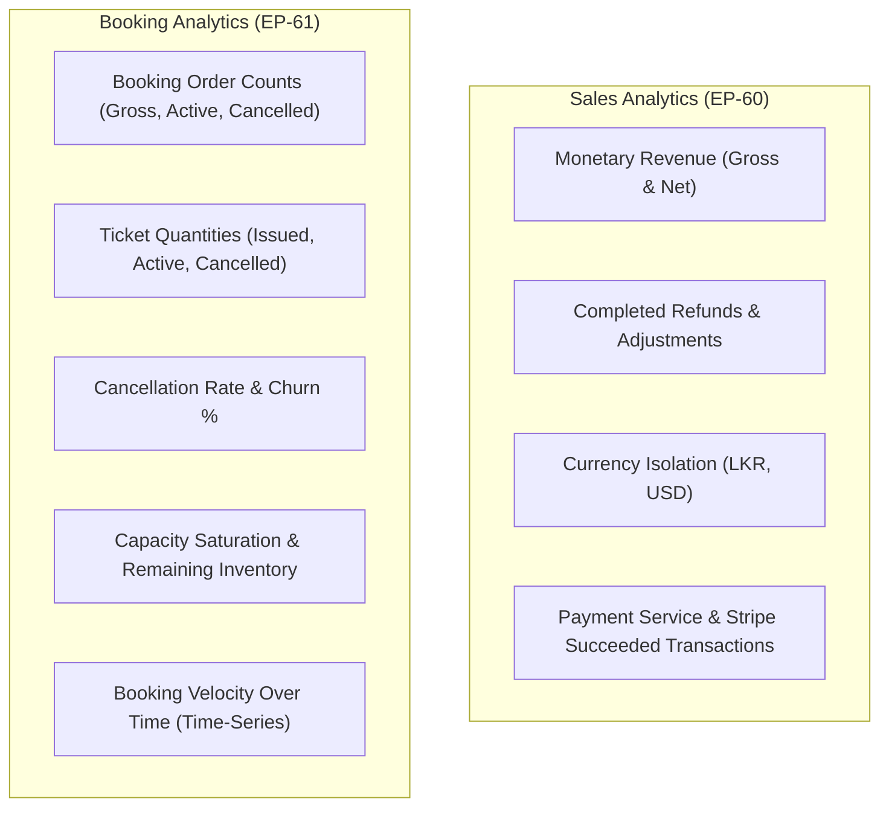
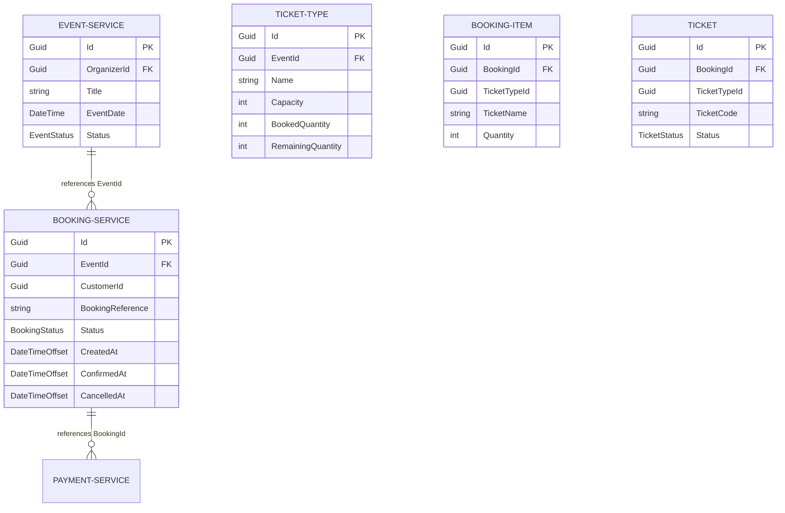
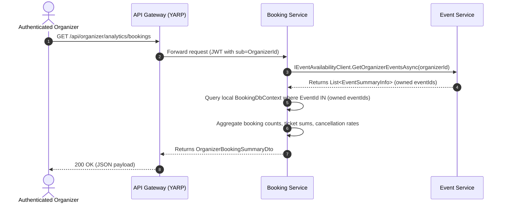

# EventPulse Booking Analytics Specification

**Document Reference:** `EP-388`  
**Parent Epic / Feature:** `EP-61` / `US-41` — Booking Analytics  
**Target Services:** Booking Service (`eventpulse_bk`), Event Service (`eventpulse_ev`), API Gateway  
**Audience:** Software Engineers, QA Automation & Test Engineers, Product Owners, Business Analysts  
**Status:** Defined Baseline & Booking Statistics Specification (Awaiting Product Owner Confirmations)  

---

## 1. Overview and Objectives

This specification defines the formal business rules, mathematical calculation formulas, cross-service data ownership boundaries, lifecycle status transitions, and architectural patterns governing **Booking Analytics** across the EventPulse platform.

While **Sales Analytics (EP-60)** focuses on monetary metrics (gross revenue, refunds, net revenue, currency breakdowns, and payment settlements), **Booking Analytics (EP-61)** governs operational transaction volumes, customer reservation behavior, attendee counts, ticket tier distribution, cancellation rates, booking velocity over time, and event capacity saturation.

In EventPulse, event configuration, ticketing capacity, booking lifecycle, and payments are decoupled across distinct microservices:
- **Event Service (`eventpulse_ev`):** Governs event scheduling, organizer ownership (`OrganizerId`), ticket type definitions (`TicketType`), venue capacity quotas, and inventory availability.
- **Booking Service (`eventpulse_bk`):** Governs customer reservation holds, multi-item line orders (`BookingItem`), individual ticket codes (`Ticket`), order lifecycle states (`BookingStatus`), and cancellation records.
- **Payment Service (`eventpulse_pm`):** Governs Stripe payment captures, webhook confirmations, and monetary refund records.
- **Apache Kafka:** Facilitates asynchronous domain event choreography (`payment-succeeded`, `payment-failed`, `booking-cancelled`, `inventory-restored`).

The primary objectives of this document are to:
1. Establish unambiguous, approved definitions for all candidate booking metrics (total bookings, confirmed bookings, cancelled bookings, bookings per event, bookings per ticket type, tickets booked per event, bookings over time, cancellation rate, and remaining ticket capacity).
2. Clearly distinguish between **Booking Count** (order transactions) and **Ticket Quantity** (attendee units), resolving multi-item and multi-tier edge cases.
3. Formalize calculation rules regarding in-flight pending reservations, failed checkouts, customer cancellations, event-level cancellations, date filtering, and timezone handling.
4. Establish cross-service data ownership without violating microservice autonomy (strictly prohibiting cross-database joins).
5. Provide developer- and QA-verifiable formulas, decision tables, worked calculation scenarios, and documented open Product Owner decisions.

---

## 2. Baseline Architecture & Codebase Inspection Findings

An exhaustive inspection of the EventPulse codebase was conducted to evaluate existing models, endpoints, and architectural patterns:

### 2.1 Entity & Schema Inspection

| Microservice | Entity / Model | Relevant Attributes | Booking Analytics Role |
| :--- | :--- | :--- | :--- |
| **Booking Service** (`eventpulse_bk`) | `Booking` | `Id`, `BookingReference`, `CustomerId`, `EventId`, `Status`, `TotalAmount`, `CreatedAt`, `ConfirmedAt`, `ExpiresAt`, `CancelledAt`, `CancelledBy`, `CancellationReason` | **Authoritative source of truth** for booking order transactions, lifecycle states, and customer linkages to `EventId`. |
| | `BookingStatus` | `PendingPayment (1)`, `Confirmed (2)`, `PaymentFailed (3)`, `Cancelled (4)` | Authoritative order lifecycle enumeration. |
| | `BookingItem` | `Id`, `BookingId`, `TicketTypeId`, `TicketName`, `Quantity`, `UnitPrice`, `Subtotal` | **Authoritative source of truth** for ticket line-item breakdowns, quantities, and tiers within an order. |
| | `Ticket` | `Id`, `BookingId`, `BookingItemId`, `TicketTypeId`, `TicketName`, `TicketSequence`, `EventId`, `TicketCode`, `ValidationToken`, `Status`, `CreatedAt` | **Authoritative source of truth** for individual attendee tickets issued. |
| | `TicketStatus` | `Valid (1)`, `Used (2)`, `Cancelled (3)` | Authoritative physical ticket status (used for gate check-in and attendance). |
| | `SalesReport` *(EP-383 Read Model)* | `Id`, `PaymentId`, `BookingId`, `EventId`, `OrganizerId`, `SaleAmount`, `Currency`, `PaymentTimestampUtc`, `RefundedAmount`, `RefundStatus` | Sales reporting read model linking confirmed sales to `OrganizerId` and `EventId`. |
| **Event Service** (`eventpulse_ev`) | `Event` | `Id`, `OrganizerId`, `Title`, `Venue`, `EventDate`, `Price`, `Status (Draft, Pending, Approved, Published, Rejected, Cancelled)` | **Authoritative source of truth** for event ownership (`OrganizerId`), event date, and scheduling. |
| | `TicketType` | `Id`, `EventId`, `Name`, `Price`, `Capacity`, `BookedQuantity`, `TotalQuantity`, `SoldQuantity`, `RemainingQuantity` | **Authoritative source of truth** for venue capacity, booked inventory, and remaining tickets. |
| | `InventoryReservation` | `Id`, `EventId`, `BookingId`, `TicketTypeId`, `Quantity`, `Status (Pending, Committed, Released)` | Authoritative temporary 15-minute checkout holds. |
| | `InventoryRestoration` | `Id`, `EventId`, `BookingId`, `CancellationKey`, `TicketTypeId`, `QuantityRestored`, `RestoredAt` | Idempotent ledger of restored inventory following booking cancellations. |

### 2.2 Existing Cross-Service Communication
1. **`IEventAvailabilityClient` in Booking Service:**  
   Booking Service already features an established HTTP client interface (`IEventAvailabilityClient`) that communicates with Event Service:
   - `GetEventSummaryAsync(Guid eventId)`: Retrieves `Id`, `Title`, `Venue`, `EventDate`, `Status`, `OrganizerId`.
   - `GetOrganizerEventsAsync(Guid organizerId)`: Retrieves all events owned by a specific organizer.
   - `GetTicketTypeAsync(Guid eventId, Guid ticketTypeId)`: Retrieves authoritative live capacity and remaining quantity.
2. **Kafka Integration Events:**  
   - `BookingCancelledIntegrationEvent` published to `booking-cancelled` topic when a booking is cancelled.
   - `PaymentSucceededEvent` published to `payment-succeeded` topic when Stripe captures payment, prompting `BookingConfirmationService` to mark `BookingStatus.Confirmed` and set `ConfirmedAt`.
   - `PaymentFailedEvent` published to `payment-failed` topic, prompting `BookingPaymentFailureService` to mark `BookingStatus.PaymentFailed`.

### 2.3 Identified Differences Between Sales Analytics & Booking Analytics



---

## 3. Core Booking Metrics Definitions & Semantic Distinctions

### 3.1 Fundamental Distinction: Booking Count vs. Ticket Quantity

A critical architectural invariant in EventPulse is that **Booking Count and Ticket Quantity are fundamentally distinct metrics**:
- **Booking Count ($B$):** The number of discrete checkout order transactions executed by customers. A booking represents a single contract/order referenced by `BookingReference`.
- **Ticket Quantity ($Q$):** The total number of individual admission tickets/seats reserved across all line items within a booking.

$$\text{One Booking } b \implies \sum_{i \in \text{Items}_b} \text{Quantity}_i \ge 1 \text{ Tickets}$$

#### Illustrative Example:
- **Order #1:** Customer buys 2 VIP tickets and 3 General Admission tickets in a single checkout.
  - Booking Count = **1**
  - Unique Ticket Types = **2**
  - Ticket Quantity = **5**
- **Order #2:** Customer buys 1 General Admission ticket.
  - Booking Count = **1**
  - Unique Ticket Types = **1**
  - Ticket Quantity = **1**
- **Cumulative Totals:**
  - Total Bookings = **2**
  - Total Tickets Booked = **6**
  - Average Tickets per Booking = **3.0**

### 3.2 Candidate Metrics Portfolio

The following 9 core metrics constitute the proposed Booking Analytics portfolio, categorized by their approval status:

| Metric Name | Short Code | Semantic Definition | Unit | Proposed Status |
| :--- | :--- | :--- | :--- | :--- |
| **Total Bookings (Gross)** | $B_{\text{gross}}$ | Cumulative count of all bookings that reached confirmed status historically ($B_{\text{active}} + B_{\text{cancelled}}$). | Orders | **Proposed Baseline** (Awaiting PO Sign-Off) |
| **Confirmed Bookings (Active)** | $B_{\text{active}}$ | Count of currently active, valid bookings that have not been cancelled. | Orders | **Approved Baseline** |
| **Cancelled Bookings** | $B_{\text{cancelled}}$ | Count of bookings that were confirmed and subsequently cancelled. | Orders | **Approved Baseline** |
| **Cancellation Rate** | $R_{\text{cancel}}$ | Proportion of confirmed bookings that were subsequently cancelled ($B_{\text{cancelled}} / B_{\text{gross}} \times 100\%$). | Percentage (%) | **Approved Baseline** |
| **Bookings per Event** | $B_{\text{event}}(e)$ | Count of bookings partitioned by specific event $e$. | Orders | **Approved Baseline** |
| **Tickets Booked per Event (Gross & Active)** | $Q_{\text{gross}}(e)$, $Q_{\text{active}}(e)$ | Total ticket quantities issued ($Q_{\text{gross}}$) and currently valid ($Q_{\text{active}}$) for event $e$. | Tickets / Seats | **Approved Baseline** |
| **Bookings per Ticket Type** | $B_{\text{tier}}(t)$ | Count of distinct bookings containing ticket type $t$. | Orders | **Proposed Baseline** (Awaiting PO Sign-Off on Multi-Tier Handling) |
| **Tickets Booked per Ticket Type** | $Q_{\text{tier}}(t)$ | Total ticket units purchased for ticket tier $t$. | Tickets / Seats | **Approved Baseline** |
| **Bookings Over Time** | $B(t_1, t_2)$ | Time-series aggregation of bookings grouped by time intervals (daily, weekly, monthly). | Orders / Day | **Proposed Baseline** (Awaiting PO Interval Sign-Off) |
| **Remaining Ticket Capacity** | $C_{\text{rem}}(e)$ | Unsold ticket capacity remaining for an event ($C_{\text{total}} - Q_{\text{active}}$). | Tickets / Seats | **Approved Baseline** (Sourced from Event Service) |

---

## 4. Precise Mathematical Formulas & Calculation Rules

### 4.1 Canonical Formulas

Let:
- $\mathcal{B}$ be the set of all booking records in the Booking Service database.
- $\mathcal{B}_{\text{confirmed}}$ be the set of bookings currently in `BookingStatus.Confirmed`.
- $\mathcal{B}_{\text{cancelled}}$ be the set of bookings currently in `BookingStatus.Cancelled` that were previously confirmed (`ConfirmedAt != null`).
- $\mathcal{B}_{\text{pending}}$ be the set of bookings in `BookingStatus.PendingPayment`.
- $\mathcal{B}_{\text{failed}}$ be the set of bookings in `BookingStatus.PaymentFailed`.
- $\mathcal{I}_b$ be the set of `BookingItem` line items belonging to booking $b$.
- $\mathcal{T}_b$ be the set of individual `Ticket` records generated for booking $b$.

#### 1. Total Confirmed Bookings (Gross / Lifetime Historical)
$$B_{\text{gross}} = |\mathcal{B}_{\text{confirmed}}| + |\mathcal{B}_{\text{cancelled}}|$$
*Note: Evaluates all orders that successfully completed checkout and payment.*

#### 2. Active Confirmed Bookings (Current Valid)
$$B_{\text{active}} = |\mathcal{B}_{\text{confirmed}}|$$
*Note: Evaluates bookings currently eligible for event attendance.*

#### 3. Cancelled Bookings
$$B_{\text{cancelled}} = |\mathcal{B}_{\text{cancelled}}|$$

#### 4. Booking Cancellation Rate ($R_{\text{cancel}}$)
$$R_{\text{cancel}} = \begin{cases} \left(\frac{B_{\text{cancelled}}}{B_{\text{gross}}}\right) \times 100\%, & \text{if } B_{\text{gross}} > 0 \\ 0.00\%, & \text{if } B_{\text{gross}} = 0 \end{cases}$$

#### 5. Gross Tickets Booked ($Q_{\text{gross}}$)
$$Q_{\text{gross}} = \sum_{b \in (\mathcal{B}_{\text{confirmed}} \cup \mathcal{B}_{\text{cancelled}})} \sum_{i \in \mathcal{I}_b} \text{Quantity}_i$$

#### 6. Active Tickets Booked ($Q_{\text{active}}$)
$$Q_{\text{active}} = \sum_{b \in \mathcal{B}_{\text{confirmed}}} \sum_{i \in \mathcal{I}_b} \text{Quantity}_i$$

#### 7. Cancelled Tickets ($Q_{\text{cancelled}}$)
$$Q_{\text{cancelled}} = \sum_{b \in \mathcal{B}_{\text{cancelled}}} \sum_{i \in \mathcal{I}_b} \text{Quantity}_i = Q_{\text{gross}} - Q_{\text{active}}$$

#### 8. Ticket Cancellation Rate ($R_{\text{ticket\_cancel}}$)
$$R_{\text{ticket\_cancel}} = \begin{cases} \left(\frac{Q_{\text{cancelled}}}{Q_{\text{gross}}}\right) \times 100\%, & \text{if } Q_{\text{gross}} > 0 \\ 0.00\%, & \text{if } Q_{\text{gross}} = 0 \end{cases}$$

#### 9. Bookings per Ticket Type ($B_{\text{tier}}(t)$)
For a specific `TicketTypeId` $t$:
$$B_{\text{tier}}(t) = \left|\left\{ b \in \mathcal{B}_{\text{confirmed}} : \exists \, i \in \mathcal{I}_b \text{ with } i.\text{TicketTypeId} = t \right\}\right|$$
*Important Invariant: If a booking contains multiple ticket types, it will be included in the order count of each respective ticket type. Therefore, $\sum_t B_{\text{tier}}(t) \ge B_{\text{active}}$.*

#### 10. Tickets Booked per Ticket Type ($Q_{\text{tier}}(t)$)
$$Q_{\text{active, tier}}(t) = \sum_{b \in \mathcal{B}_{\text{confirmed}}} \sum_{\substack{i \in \mathcal{I}_b \\ i.\text{TicketTypeId} = t}} \text{Quantity}_i$$
$$Q_{\text{gross, tier}}(t) = \sum_{b \in (\mathcal{B}_{\text{confirmed}} \cup \mathcal{B}_{\text{cancelled}})} \sum_{\substack{i \in \mathcal{I}_b \\ i.\text{TicketTypeId} = t}} \text{Quantity}_i$$
*Strict Additive Invariant: $\sum_t Q_{\text{active, tier}}(t) = Q_{\text{active}}$ and $\sum_t Q_{\text{gross, tier}}(t) = Q_{\text{gross}}$.*

#### 11. Remaining Ticket Capacity ($C_{\text{rem}}(e)$)
Let $\mathcal{K}_e$ be the set of ticket tiers configured for event $e$ in Event Service:
$$C_{\text{total}}(e) = \sum_{k \in \mathcal{K}_e} \text{Capacity}_k$$
$$C_{\text{rem}}(e) = \sum_{k \in \mathcal{K}_e} \text{RemainingQuantity}_k = \sum_{k \in \mathcal{K}_e} \max(0, \text{Capacity}_k - \text{BookedQuantity}_k)$$

#### 12. Capacity Saturation / Booking Utilization Rate ($\text{BUR}(e)$)
$$\text{BUR}(e) = \begin{cases} \left(\frac{Q_{\text{active}}(e)}{C_{\text{total}}(e)}\right) \times 100\%, & \text{if } C_{\text{total}}(e) > 0 \\ 0.00\%, & \text{otherwise} \end{cases}$$

#### 13. Average Tickets per Booking ($\text{ATB}$)
$$\text{ATB} = \begin{cases} \frac{Q_{\text{active}}}{B_{\text{active}}}, & \text{if } B_{\text{active}} > 0 \\ 0.00, & \text{otherwise} \end{cases}$$

---

### 4.2 Detailed Business Rules & Invariant Constraints

#### Rule 1: Exclusion of Pending and In-Flight Bookings
- **`BookingStatus.PendingPayment`** represents an active checkout in progress holding inventory under a 15-minute countdown timer.
- **Rule:** `PendingPayment` bookings MUST be **strictly excluded** from completed booking totals ($B_{\text{gross}}$, $B_{\text{active}}$) and tickets booked counts.
- **Rationale:** Including in-flight reservations would distort attendance and sales conversion rates if the user abandons checkout. (Such reservations may be exposed only in real-time operational inventory telemetry, never in historical booking analytics).

#### Rule 2: Exclusion of Failed-Payment Bookings
- **`BookingStatus.PaymentFailed`** represents an abandoned or card-declined checkout.
- **Rule:** `PaymentFailed` bookings MUST be **strictly excluded** from all booking counts, ticket quantities, and cancellation calculations.
- **Rationale:** A failed payment is a checkout abandonment, not a booking cancellation. Conflating payment declines with booking cancellations invalidates churn analysis.

#### Rule 3: Historical Preservation of Cancelled Bookings
- **Rule:** A booking that is cancelled remains preserved in the historical gross booking count ($B_{\text{gross}}$) and historical gross ticket count ($Q_{\text{gross}}$).
- **Rule:** A cancelled booking is removed from the active booking count ($B_{\text{active}}$) and active ticket count ($Q_{\text{active}}$).
- **Rationale:** Preserves historical demand metrics (how many people originally booked) while accurately reflecting current operational attendance.

#### Rule 4: Denominator for Cancellation Rate
- **Rule:** The denominator for the Booking Cancellation Rate MUST be **Gross Confirmed Bookings** ($B_{\text{gross}} = B_{\text{active}} + B_{\text{cancelled}}$).
- **Prohibited:** Never use all database records ($|\mathcal{B}|$) as the denominator, because unfinalized carts and failed card attempts would artificially deflate the cancellation rate.
- **Zero Invariant:** If $B_{\text{gross}} = 0$, $R_{\text{cancel}} = 0.00\%$.

#### Rule 5: Multi-Tier Bookings Handling
- When a booking contains multiple ticket types (e.g., VIP and General Admission):
  1. For overall booking count, it contributes exactly **$1$** to $B_{\text{active}}$.
  2. For tier-specific ticket counts ($Q_{\text{tier}}$), each line item contributes its respective quantity.
  3. For tier-specific booking counts ($B_{\text{tier}}$), the booking increments the order count of each contained tier by **$1$**.
  4. Dashboards presenting tier-level breakdowns MUST label order counts as *"Orders containing this ticket type"* to prevent users from summing tier order counts and expecting the total to equal $B_{\text{active}}$.

#### Rule 6: Event-Level Cancellation Impact
- If an entire event is cancelled by the Organizer or Administrator (`Event.Status == Cancelled` in Event Service):
  - In EventPulse, event cancellation triggers automated bulk cancellation of all remaining active bookings.
  - **Analytics Rule:** The booking service records these cancellations with `CancelledBy = "SYSTEM"` or `CancellationReason = "Event cancelled by organizer"`.
  - **Distinction:** Organizers and administrators must be able to view **Customer-Initiated Cancellations** vs. **Event-Level Administrative Cancellations** to prevent skewing customer satisfaction metrics when the event itself was cancelled.

#### Rule 7: Booking Date vs. Event Date
- **Booking Date (`Booking.ConfirmedAt`):** The timestamp when the customer completed purchase.
- **Event Date (`Event.EventDate`):** The scheduled calendar date and time when the physical event takes place.
- **Rule:** Date-range filters in Booking Analytics (`from`, `to`) MUST filter on **`Booking.ConfirmedAt`** (the transaction occurrence date), NOT `Event.EventDate`.
- **Rationale:** Booking analytics measures sales velocity, ticket purchasing spikes, and campaign effectiveness over time. Filtering by event date would omit sales velocity trends leading up to an event.

#### Rule 8: Date Range Filtering & Timezone Rules
- **Canonical Timezone:** All database queries and comparisons MUST be performed strictly in **Coordinated Universal Time (UTC)** using `DateTimeOffset`.
- **Query Boundary:**
  $$\text{ConfirmedAtUtc} \ge \text{FromUtc} \quad \text{AND} \quad \text{ConfirmedAtUtc} \le \text{ToUtc}$$
- If a date-only filter is provided (e.g., `from=2026-10-01&to=2026-10-07`):
  - `FromUtc` is evaluated at start of day: `2026-10-01T00:00:00.000Z`.
  - `ToUtc` is evaluated at end of day: `2026-10-07T23:59:59.999Z`.
- Client applications must convert local time to UTC prior to API transmission, or display returned UTC timestamps in the viewer's local browser timezone.

#### Rule 9: Authoritative Inventory Source for Remaining Capacity
- **Rule:** The single source of truth for event capacity and remaining tickets is **Event Service (`eventpulse_ev`)**, NOT Booking Service.
- Event Service maintains `TicketType.Capacity`, `BookedQuantity`, and `RemainingQuantity`.
- When bookings are confirmed, Booking Service commits inventory in Event Service. When bookings are cancelled, Booking Service calls `RestoreInventoryAsync` in Event Service, which increments `RemainingQuantity` (provided the event has not concluded).
- **Rule:** Booking analytics queries for remaining capacity MUST resolve live inventory from Event Service via `IEventAvailabilityClient` or an event-driven inventory projection.

---

## 5. Cross-Service Data Ownership & Architecture

### 5.1 Microservice Ownership Matrix

To preserve loose coupling and domain-driven bounded contexts, each microservice owns specific facets of the data:



| Domain Element | Owning Service | Database | Access Pattern for Analytics |
| :--- | :--- | :--- | :--- |
| **Booking Records & Statuses** | Booking Service | `eventpulse_bk` (`Bookings`) | Direct EF Core Query (`BookingDbContext`) |
| **Booking Line Items & Quantities** | Booking Service | `eventpulse_bk` (`BookingItems`) | Direct EF Core Query (`Include(b => b.Items)`) |
| **Individual Tickets & Codes** | Booking Service | `eventpulse_bk` (`Tickets`) | Direct EF Core Query (`Include(b => b.Tickets)`) |
| **Cancellation Timestamps & Reasons** | Booking Service | `eventpulse_bk` (`Bookings`) | Direct EF Core Query (`CancelledAt`, `CancellationReason`) |
| **Organizer Ownership (`OrganizerId`)** | Event Service | `eventpulse_ev` (`Events`) | Queried via `IEventAvailabilityClient.GetOrganizerEventsAsync` |
| **Event Metadata (Title, Date, Venue)**| Event Service | `eventpulse_ev` (`Events`) | Queried via `IEventAvailabilityClient.GetEventSummaryAsync` |
| **Ticket Tier Capacities & Inventory** | Event Service | `eventpulse_ev` (`TicketTypes`) | Live query via `IEventAvailabilityClient` |

### 5.2 Architectural Strategy (Smallest Compatible Design)

To compute booking statistics for an authenticated organizer without performing distributed database joins:



1. **Step 1:** The authenticated organizer sends a request. The controller verifies the `Organizer` role and extracts `OrganizerId` from JWT claims (`sub` / `nameid`).
2. **Step 2:** Booking Service queries Event Service via `IEventAvailabilityClient.GetOrganizerEventsAsync(organizerId)`. This returns the authoritative list of events owned by that organizer (`EventSummaryInfo` containing `Id`, `Title`, `EventDate`, `Status`).
3. **Step 3:** Booking Service executes an in-boundary EF Core query on `BookingDbContext.Bookings`:
   ```csharp
   var ownedEventIds = ownedEvents.Select(e => e.Id).ToList();
   var bookings = await _dbContext.Bookings
       .Include(b => b.Items)
       .Where(b => ownedEventIds.Contains(b.EventId))
       .Where(b => b.Status == BookingStatus.Confirmed || b.Status == BookingStatus.Cancelled)
       .ToListAsync(ct);
   ```
4. **Step 4:** Booking Service aggregates metrics in memory or via grouped database projections, adhering to all canonical formulas.
5. **Advantages:**
   - **Zero cross-database SQL joins:** Maintains strict microservice encapsulation.
   - **Reuses existing infrastructure:** Leverages the tested `IEventAvailabilityClient` already implemented in Booking Service.
   - **Guaranteed tenancy:** An organizer can never access bookings for events owned by another organizer because the `EventId` list is strictly filtered by `OrganizerId`.

---

## 6. Worked Walkthrough Examples & Decision Scenarios

The following concrete test scenarios establish reference benchmarks for developers and QA engineers:

### Scenario 1: Standard Multi-Item Booking (Happy Path)
- **Event:** *Colombo Tech Fest 2026* (`EventId: evt-101`)
  - Ticket Tier 1: **VIP Pass** (Capacity: 50)
  - Ticket Tier 2: **General Admission** (Capacity: 200)
- **Orders Processed:**
  - `Booking-A`: Confirmed. Items: 2 VIP Pass, 3 General Admission (Total Tickets: 5).
  - `Booking-B`: Confirmed. Items: 1 General Admission (Total Tickets: 1).
  - `Booking-C`: Confirmed. Items: 1 VIP Pass (Total Tickets: 1).

**Calculated Booking Metrics:**
- **Gross Bookings ($B_{\text{gross}}$):** $3$
- **Active Bookings ($B_{\text{active}}$):** $3$
- **Cancelled Bookings ($B_{\text{cancelled}}$):** $0$
- **Cancellation Rate ($R_{\text{cancel}}$):** $0.00\%$
- **Gross Tickets Booked ($Q_{\text{gross}}$):** $7$ (3 VIP, 4 General)
- **Active Tickets Booked ($Q_{\text{active}}$):** $7$
- **Average Tickets per Booking ($\text{ATB}$):** $7 / 3 \approx 2.33$
- **Metrics by Ticket Type:**
  - VIP Pass: Orders Containing Tier = $2$ (`Booking-A`, `Booking-C`), Tickets Sold = $3$.
  - General Admission: Orders Containing Tier = $2$ (`Booking-A`, `Booking-B`), Tickets Sold = $4$.
  - *Sum of tier orders ($2 + 2 = 4$) exceeds total unique bookings ($3$) as expected.*
- **Remaining Capacity:**
  - VIP Remaining: $50 - 3 = 47$
  - General Remaining: $200 - 4 = 196$
  - Total Event Remaining: $243$ / $250$

---

### Scenario 2: Booking Cancellation & Rate Calculation
- **Event:** *Lanka Music Carnival* (`EventId: evt-102`)
- **Orders Processed:**
  - `Booking-01`: Confirmed (2 tickets).
  - `Booking-02`: Confirmed (4 tickets).
  - `Booking-03`: Confirmed (1 ticket).
  - `Booking-04`: Confirmed (3 tickets).
- **Subsequent Action:**
  - Customer cancels `Booking-02` (4 tickets) 5 days before the event (within eligible cancellation cutoff).
  - Status transitions to `BookingStatus.Cancelled`. 4 tickets marked `TicketStatus.Cancelled`. Event inventory restored.

**Calculated Booking Metrics:**
- **Gross Bookings ($B_{\text{gross}}$):** $4$ (All 4 orders originally took place)
- **Active Bookings ($B_{\text{active}}$):** $3$ (`Booking-01`, `Booking-03`, `Booking-04`)
- **Cancelled Bookings ($B_{\text{cancelled}}$):** $1$ (`Booking-02`)
- **Booking Cancellation Rate ($R_{\text{cancel}}$):** $(1 / 4) \times 100\% = \mathbf{25.00\%}$
- **Gross Tickets Booked ($Q_{\text{gross}}$):** $2 + 4 + 1 + 3 = \mathbf{10}$
- **Active Tickets Booked ($Q_{\text{active}}$):** $2 + 1 + 3 = \mathbf{6}$
- **Cancelled Tickets ($Q_{\text{cancelled}}$):** $\mathbf{4}$
- **Ticket Cancellation Rate ($R_{\text{ticket\_cancel}}$):** $(4 / 10) \times 100\% = \mathbf{40.00\%}$

---

### Scenario 3: Mixed In-Flight and Failed Checkouts
- **Event:** *Startup Showcase* (`EventId: evt-103`)
- **Records in Database:**
  - `Booking-11`: Status `Confirmed`, 2 tickets.
  - `Booking-12`: Status `PendingPayment` (Customer is typing card details on Stripe), 3 tickets.
  - `Booking-13`: Status `PaymentFailed` (Card declined), 2 tickets.
  - `Booking-14`: Status `Confirmed`, 1 ticket.
  - `Booking-15`: Status `Cancelled` (Previously confirmed, then cancelled), 1 ticket.

**Calculated Booking Metrics:**
- **Included Bookings:** `Booking-11`, `Booking-14`, `Booking-15` (Confirmed and Cancelled).
- **Excluded Bookings:** `Booking-12` (PendingPayment) and `Booking-13` (PaymentFailed).
- **Gross Bookings ($B_{\text{gross}}$):** $3$ (`11`, `14`, `15`)
- **Active Bookings ($B_{\text{active}}$):** $2$ (`11`, `14`)
- **Cancelled Bookings ($B_{\text{cancelled}}$):** $1$ (`15`)
- **Cancellation Rate ($R_{\text{cancel}}$):** $(1 / 3) \times 100\% = \mathbf{33.33\%}$
- **Active Tickets ($Q_{\text{active}}$):** $2 + 1 = \mathbf{3}$ tickets

---

## 7. Developer & QA Test Calculation Table

Developers writing unit/integration tests and QA engineers verifying API output can validate calculations against this reference table:

| Metric | Scenario 1 (Happy Path) | Scenario 2 (With Cancellation) | Scenario 3 (With Pending/Failed) | Formula / Verification Rule |
| :--- | :---: | :---: | :---: | :--- |
| **Total Gross Bookings** | $3$ | $4$ | $3$ | Count of bookings with `ConfirmedAt != null` |
| **Active Bookings** | $3$ | $3$ | $2$ | Count where `Status == Confirmed` |
| **Cancelled Bookings** | $0$ | $1$ | $1$ | Count where `Status == Cancelled && ConfirmedAt != null` |
| **Pending Bookings** | $0$ | $0$ | $1$ *(Excluded)* | `Status == PendingPayment` (Must NOT alter $B_{\text{gross}}$) |
| **Failed Bookings** | $0$ | $0$ | $1$ *(Excluded)* | `Status == PaymentFailed` (Must NOT alter $B_{\text{gross}}$) |
| **Booking Cancellation Rate** | $0.00\%$ | $25.00\%$ | $33.33\%$ | $(B_{\text{cancelled}} / B_{\text{gross}}) \times 100\%$ |
| **Gross Tickets Booked** | $7$ | $10$ | $4$ | Sum of `Quantity` for Confirmed + Cancelled |
| **Active Tickets Booked** | $7$ | $6$ | $3$ | Sum of `Quantity` for currently Confirmed |
| **Cancelled Tickets** | $0$ | $4$ | $1$ | Sum of `Quantity` for Cancelled bookings |
| **Ticket Cancellation Rate** | $0.00\%$ | $40.00\%$ | $25.00\%$ | $(Q_{\text{cancelled}} / Q_{\text{gross}}) \times 100\%$ |
| **Average Tickets / Booking** | $2.33$ | $2.00$ | $1.50$ | $Q_{\text{active}} / B_{\text{active}}$ |

---

## 8. Summary of Unresolved Decisions (Pending Product Owner Confirmation)

The following design decisions and business rules are documented as open decisions requiring Product Owner confirmation:

| Decision ID | Topic | Options / Proposed Default | Impacted Scope | Status |
| :--- | :--- | :--- | :--- | :--- |
| **PO-BA-01** | **Primary Denominator for Cancellation Rate** | **Proposed Default:** $B_{\text{cancelled}} / (B_{\text{active}} + B_{\text{cancelled}})$.<br>*Alternative:* Use ticket quantities instead of booking counts ($Q_{\text{cancelled}} / Q_{\text{gross}}$). | API summary metrics & KPI cards | **AWAITING PO CONFIRMATION** |
| **PO-BA-02** | **Multi-Tier Order Representation** | **Proposed Default:** In tier breakdowns, show both "Orders containing tier" and "Tickets sold for tier".<br>*Alternative:* Only show ticket quantities per tier. | Tier table UI & DTO schema | **AWAITING PO CONFIRMATION** |
| **PO-BA-03** | **Event-Level Cancellation Segregation** | **Proposed Default:** Flag and isolate event-wide administrative cancellations from customer self-service cancellations in cancellation rate calculations.<br>*Alternative:* Group all cancellations into a single count. | Cancellation metrics & churn analytics | **AWAITING PO CONFIRMATION** |
| **PO-BA-04** | **Time-Series Grouping Granularity** | **Proposed Default:** Dynamic bucketing based on date range: Daily for $\le 30$ days, Weekly for $31-90$ days, Monthly for $>90$ days.<br>*Alternative:* Fixed daily bucketing with explicit client interval query parameter (`interval=day\|week\|month`). | `BookingsOverTime` API & chart | **AWAITING PO CONFIRMATION** |
| **PO-BA-05** | **Partial Ticket Cancellation Tracking** | **Proposed Default:** Track cancellation at individual `Ticket` level as well as `Booking` level.<br>*Alternative:* Only support full booking cancellations in baseline. | Line item cancellation statistics | **AWAITING PO CONFIRMATION** |
| **PO-BA-06** | **Pending Cart Reservations Visibility** | **Proposed Default:** Exclude from all booking analytics. Add separate operational "Cart Holds" telemetry widget in a future story.<br>*Alternative:* Display as an informational sub-metric. | Summary cards | **AWAITING PO CONFIRMATION** |

---

## 9. Implementation Roadmap & Dependencies for EP-389

Upon product-owner review and approval of this specification, backend development proceeds under **EP-389 (Booking analytics: aggregate booking data backend)**.

### Dependencies & Deliverables for EP-389:
1. **DTO Definitions:**
   - `OrganizerBookingSummaryDto`: Overall metrics across all events (`TotalBookings`, `ActiveBookings`, `CancelledBookings`, `TotalTicketsBooked`, `ActiveTicketsBooked`, `CancellationRate`, `AverageTicketsPerBooking`).
   - `EventBookingAnalyticsDto`: Event-specific breakdown including ticket tier distributions, remaining capacities, and time-series points.
   - `TicketTypeBookingDto`: Tier-level stats (`TicketTypeId`, `Name`, `TicketsSold`, `OrdersCount`, `Capacity`, `RemainingCapacity`).
   - `BookingTimeSeriesPointDto`: `TimestampUtc`, `BookingsCount`, `TicketsCount`.
2. **Service Implementation:**
   - Create `IOrganizerBookingAnalyticsService` and `OrganizerBookingAnalyticsService` in `EventPulse.BookingService`.
   - Leverage `IEventAvailabilityClient` to resolve organizer event ownership and tier capacity.
3. **Controller & Gateway Endpoints (EP-390):**
   - `GET /api/organizer/analytics/bookings/summary`
   - `GET /api/organizer/analytics/bookings/events/{eventId}`
4. **Security & Ownership Hardening (EP-391):**
   - Organizer role authorization and event ownership validation.
5. **Frontend View (EP-392):**
   - Organizer Booking Analytics page with summary cards, booking trends chart, and ticket tier distribution tables.
