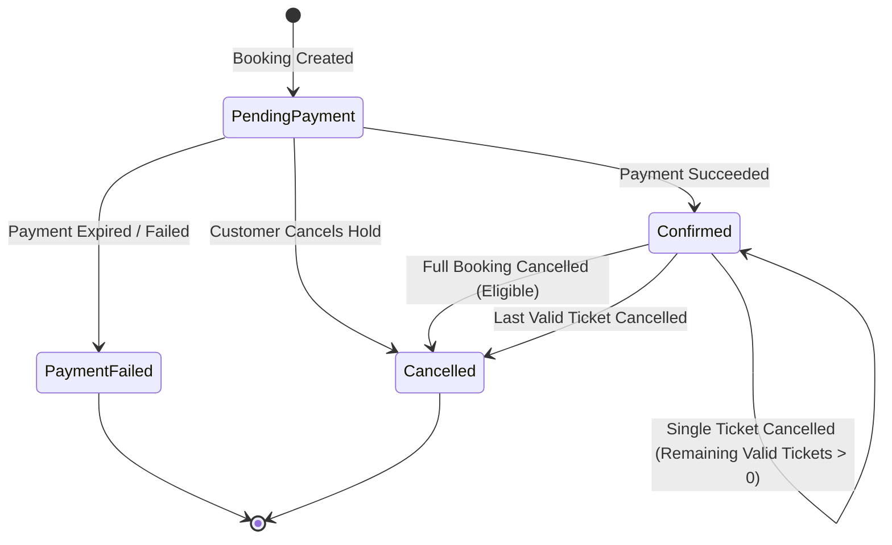
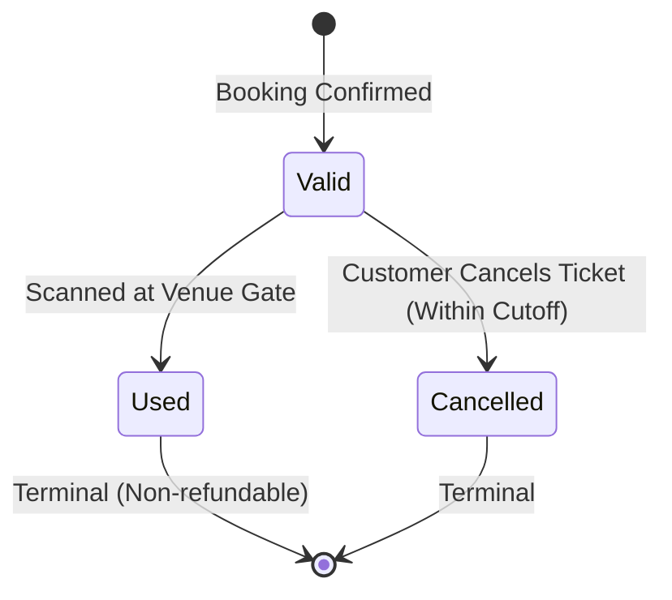
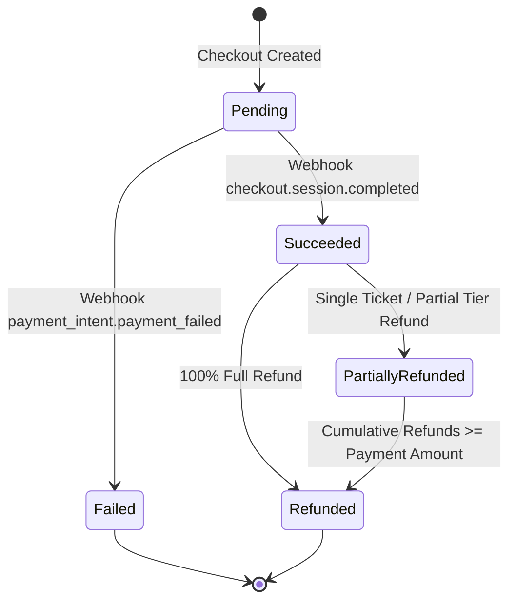

# EventPulse Booking Cancellation & Refund Policy

**Document Reference:** `EP-361`  
**Parent Epic / Feature:** `EP-55` / `US-35` — Apply Booking Cancellation Rules  
**Target Services:** Booking Service, Payment Service, Event Service  
**Audience:** Software Engineers, QA Automation & Test Engineers, Product Owners  
**Status:** Defined Baseline & Policy Specification (Pending Product Owner Parameter Approvals)

---

## 1. Overview and Objectives

This specification defines the formal business rules, technical state machines, error taxonomies, and cross-service invariants governing booking and individual ticket cancellations across the EventPulse platform.

In EventPulse, bookings and payments are distributed across distinct microservices:
- **Booking Service (`eventpulse_bk`):** Governs booking lifecycles, ticket codes, reservation holds, and cancellation eligibility checks.
- **Event Service (`eventpulse_ev`):** Governs event dates, schedules, capacity quotas, ticket tiers, and inventory restoration.
- **Payment Service (`eventpulse_pm`):** Governs Stripe transactions, payment statuses, and refund records.
- **Apache Kafka:** Facilitates asynchronous domain event choreography (`booking-cancelled`, `ticket-cancelled`, `booking-refund-requested`, `payment-refunded`).

The primary objective of this document is to eliminate ambiguities between product requirements and technical implementations, providing developers and QA with verifiable decision matrices, status transition guarantees, and cutoff definitions.

---

## 2. Current Implementation Analysis (Sprint 1–3 Baseline)

Prior to Sprint 4 (EP-55 / EP-361), initial cancellation scaffolding was introduced under EP-308 and EP-401. An inspection of the codebase identified the following baseline behavior and architectural gaps:

| Component / Service | Current Behavior | Gap / Unresolved Requirement |
| :--- | :--- | :--- |
| **Booking Service** (`BookingCancellationService.cs`) | • Validates customer ownership (`CustomerId == callerId`).<br>• Blocks already cancelled bookings (`Status != Cancelled`).<br>• Blocks failed payment bookings (`Status != PaymentFailed`).<br>• Emits 100% refund request unconditionally for `Confirmed` bookings with `TotalAmount > 0`. | • **No Cutoff Window Check:** Does not query event date or enforce any time limit prior to event start.<br>• **No Event Date Validation:** Does not block cancellations after an event has started or completed.<br>• **No Tiered Calculations:** Fixed to 100% refund; cannot support cancellation fees or tiered deductions. |
| **Event Service** (`EventInventoryService.cs`) | • `ReleaseInventoryAsync` releases 15-minute temporary holds for `PendingPayment`.<br>• `RestoreInventoryAsync` restores capacity (`BookedQuantity`) using an idempotent `CancellationKey`. | • **No Event Date Validation:** Will restore inventory to public sale even if the event has already ended or is currently in progress.<br>• Historical attendance reporting would be distorted if past-event inventory is altered. |
| **Payment Service** (`PaymentRefundService.cs`) | • Consumes `BookingRefundRequestedEvent`.<br>• Idempotently creates `RefundRecord` in PostgreSQL.<br>• Updates payment status to `Refunded` or `PartiallyRefunded`.<br>• Emits `PaymentRefundedEvent` via Outbox Pattern. | • **No Stripe Refund API Call:** Only updates local database tables. Does not initiate payment reversal with Stripe (`Stripe.RefundService.CreateAsync`).<br>• **No Refund Failure Recovery:** If refund processing fails, booking remains cancelled without automated compensation or alert. |

---

## 3. Core Policy Rules & Cutoff Boundary Specifications

### 3.1 Precise Cutoff Boundary & Timezone Behavior

1. **Strict UTC Canonical Reference:**  
   All event dates and timestamps in EventPulse are persisted and evaluated in **Coordinated Universal Time (UTC)**.  
   - Event Date: `Event.EventDate` is stored as UTC.
   - Current System Clock: `DateTimeOffset.UtcNow`.
   - **Rule:** The calculation of time until event start MUST be computed strictly as:
     $$\Delta t = \text{EventDateUtc} - \text{DateTimeOffset.UtcNow}$$
   - Any client-side local time offsets MUST NOT influence eligibility calculations.

2. **Cutoff Thresholds:**  
   - Let $T_{\text{cutoff}}$ be the defined cancellation cutoff window (e.g., 48 hours).
   - **Eligible Window:** $\Delta t > T_{\text{cutoff}}$. Customer self-service cancellation is permitted.
   - **Restricted / Late Window:** $0 < \Delta t \le T_{\text{cutoff}}$. Customer self-service cancellation is either prohibited or subject to reduced refund tiers, per PO policy.
   - **Post-Start / Completed Window:** $\Delta t \le 0$. The event has commenced or concluded. Customer self-service cancellation is **strictly prohibited**.

3. **Boundary Precision:**  
   The boundary comparison evaluates down to the exact second at evaluation time:
   ```csharp
   TimeSpan timeRemaining = eventDateUtc - DateTimeOffset.UtcNow;
   if (timeRemaining <= TimeSpan.Zero)
   {
       // Event has already started or ended
       return (false, "EVENT_ALREADY_STARTED");
   }
   if (timeRemaining < cutoffThreshold)
   {
       // Cutoff window passed
       return (false, "CANCELLATION_CUTOFF_EXCEEDED");
   }
   ```

### 3.2 Product Owner Sign-Off Parameters

> [!IMPORTANT]
> The exact hourly cutoff windows and refund percentage tiers below represent proposed industry best practices and must receive formal sign-off from the Product Owner before implementation in EP-362 / EP-363.

- **Parameter 1: Full Refund Cutoff Window ($T_{\text{full}}$):**  
  *Proposed:* **48 Hours** before `EventDateUtc` $\rightarrow$ 100% ticket price refunded.  
  *Status:* **[PENDING PRODUCT OWNER APPROVAL]**

- **Parameter 2: Partial Refund Cutoff Window ($T_{\text{partial}}$):**  
  *Proposed:* **24 to 48 Hours** before `EventDateUtc` $\rightarrow$ 50% ticket price refunded.  
  *Status:* **[PENDING PRODUCT OWNER APPROVAL]**

- **Parameter 3: Non-Refundable Cutoff Window ($T_{\text{non-ref}}$):**  
  *Proposed:* **< 24 Hours** before `EventDateUtc` $\rightarrow$ 0% refund (cancellation prohibited or forfeiture of fee).  
  *Status:* **[PENDING PRODUCT OWNER APPROVAL]**

- **Parameter 4: Processing Fee / Administrative Surcharge:**  
  *Proposed:* Flat fee (e.g., LKR 200 / $2.00) or 5% processing surcharge deducted from all refunds.  
  *Status:* **[PENDING PRODUCT OWNER APPROVAL]**

---

## 4. Eligibility Decision Table

The following decision table establishes whether a cancellation request (full booking or single ticket) is accepted, and what conditions apply:

| # | Booking Status | Payment Status | Event Timeline State | Ticket Status (Single Ticket) | Cancellation Allowed? | Refund Action | Inventory Action | Reason / Error Code |
| :- | :--- | :--- | :--- | :--- | :--- | :--- | :--- | :--- |
| **1** | `PendingPayment` | None / Pending | Upcoming ($\Delta t > T_{\text{cutoff}}$) | Valid | **YES** | None ($0.00) | Release reservation hold (15-min lock) | `BOOKING_CANCELLED_PENDING` |
| **2** | `PendingPayment` | None / Pending | Upcoming ($\Delta t \le T_{\text{cutoff}}$) | Valid | **YES** | None ($0.00) | Release reservation hold | `BOOKING_CANCELLED_PENDING` |
| **3** | `PendingPayment` | None / Pending | Event Started ($\Delta t \le 0$) | Valid | **NO** (Auto-expired) | None | System auto-expires pending reservations | `EVENT_ALREADY_STARTED` |
| **4** | `Confirmed` | Succeeded | Upcoming ($\Delta t > T_{\text{full}}$) | Valid | **YES** | Full Refund (100% ticket amount) | Restore inventory capacity (`BookedQuantity - N`) | `CANCELLATION_SUCCESSFUL_FULL_REFUND` |
| **5** | `Confirmed` | Succeeded | Upcoming ($T_{\text{partial}} < \Delta t \le T_{\text{full}}$) | Valid | **YES** | Partial Refund (50% or policy tier) | Restore inventory capacity (`BookedQuantity - N`) | `CANCELLATION_SUCCESSFUL_PARTIAL_REFUND` |
| **6** | `Confirmed` | Succeeded | Upcoming ($\Delta t \le T_{\text{non-ref}}$) | Valid | **NO** | No Refund | No inventory restoration | `CANCELLATION_CUTOFF_EXCEEDED` |
| **7** | `Confirmed` | Succeeded | Event Started / Completed ($\Delta t \le 0$) | Valid | **NO** | No Refund | No inventory restoration (Never restore past events) | `EVENT_ALREADY_STARTED` |
| **8** | `Confirmed` | Succeeded | Any | Used / Scanned | **NO** | No Refund | No inventory restoration | `TICKET_ALREADY_USED` |
| **9** | `Confirmed` | Succeeded | Any | Already Cancelled | **NO** | No Refund | None (Already processed) | `TICKET_ALREADY_CANCELLED` |
| **10** | `Confirmed` | PartiallyRefunded | Upcoming ($\Delta t > T_{\text{cutoff}}$) | Valid (remaining) | **YES** | Refund proportional ticket amount | Restore inventory capacity for cancelled ticket | `CANCELLATION_SUCCESSFUL_PARTIAL` |
| **11** | `PaymentFailed` | Failed | Any | Valid / None | **NO** | No Refund (No charge captured) | None (Hold expired or cleared upon failure) | `PAYMENT_FAILED_CANNOT_CANCEL` |
| **12** | `Cancelled` | Any | Any | Any | **NO** | No Refund | None | `BOOKING_ALREADY_CANCELLED` |
| **13** | Any | Any | Event Cancelled by Organizer | Any | **AUTO-CANCELLED** | 100% Mandatory Refund (System wide) | Release / Clear all capacity | `EVENT_CANCELLED_BY_ORGANIZER` |

---

## 5. Refund Decision Table & Financial Calculations

This table governs how refund amounts are computed when a cancellation is approved:

| Cancellation Context | Trigger Event | Policy Calculation Rule | Payment Status Transition | Outbound Kafka Event |
| :--- | :--- | :--- | :--- | :--- |
| **Full Booking Cancellation (Window > 48h)** | Customer cancels entire booking | $R = \text{TotalAmount}$ | `Succeeded` $\rightarrow$ `Refunded` | `BookingRefundRequestedEvent` ($R = \text{TotalAmount}$) |
| **Full Booking Cancellation (24h < Window $\le$ 48h)** | Customer cancels entire booking | $R = \text{TotalAmount} \times 0.50$ *(Subject to PO Approval)* | `Succeeded` $\rightarrow$ `PartiallyRefunded` | `BookingRefundRequestedEvent` ($R = \text{TotalAmount} \times 0.50$) |
| **Single Ticket Cancellation (Window > 48h)** | Customer cancels 1 ticket out of $M$ | $R = \text{TicketUnitPrice}$ | `Succeeded` $\rightarrow$ `PartiallyRefunded` *(or `Refunded` if last ticket)* | `BookingRefundRequestedEvent` ($R = \text{UnitPrice}$) |
| **Single Ticket Cancellation (24h < Window $\le$ 48h)** | Customer cancels 1 ticket out of $M$ | $R = \text{TicketUnitPrice} \times 0.50$ *(Subject to PO Approval)* | `Succeeded` $\rightarrow$ `PartiallyRefunded` | `BookingRefundRequestedEvent` ($R = \text{UnitPrice} \times 0.50$) |
| **Non-Refundable Window (< 24h)** | Customer requests cancellation | $R = 0.00$ (Rejection or No Refund) | Unchanged (`Succeeded`) | None |
| **Booking in PendingPayment** | Customer cancels uncompleted booking | $R = 0.00$ (No funds ever captured) | `Pending` (no charge) | None |
| **Organizer Cancels Event** | Admin/Organizer cancels event | $R = \text{TotalAmount}$ (100% full refund unconditionally) | `Succeeded` $\rightarrow$ `Refunded` | `EventCancelledRefundRequestedEvent` |

### 5.1 Refund Failure & Reconciliation Procedure
If payment refund processing fails (e.g., Stripe API error, expired card, network timeout):
1. **Idempotent Record:** A `RefundRecord` MUST NOT be marked as successful until confirmed by Stripe.
2. **Outbox Pattern:** Payment Service enqueues the refund request. If transient, exponential backoff retries are attempted up to 5 times.
3. **Dead Letter Queue (DLQ):** If retries are exhausted, the event is routed to `payment-refunds-dlq`.
4. **Audit Status:** The Payment record transitions to `RefundFailed`. The booking remains `Cancelled` in Booking Service, and an operational alert is dispatched for manual finance review.

---

## 6. Status State Machine Transitions

### 6.1 Booking Status State Transitions



#### Booking Transition Invariants:
1. `PendingPayment` $\rightarrow$ `Cancelled`: Immediate status update; releases temporary hold in Event Service; no Kafka refund event.
2. `Confirmed` $\rightarrow$ `Cancelled`: Allowed only if $\Delta t > T_{\text{cutoff}}$ and at least one ticket is `Valid`. Invalidates all child tickets to `Cancelled`. Restores inventory.
3. Terminal States: `Cancelled` and `PaymentFailed` are terminal. No transitions out of these states are permitted.

---

### 6.2 Ticket Status State Transitions



#### Ticket Transition Invariants:
1. Only tickets in `TicketStatus.Valid` may be cancelled.
2. A ticket in `TicketStatus.Used` can **never** be cancelled or refunded.
3. Cancelling a single ticket checks remaining tickets:
   - If any valid tickets remain $\rightarrow$ Parent Booking remains `Confirmed`.
   - If zero valid tickets remain $\rightarrow$ Parent Booking transitions to `Cancelled`.

---

### 6.3 Payment & Refund Status State Transitions



#### Payment Transition Invariants:
1. $\sum \text{RefundRecord.Amount} = \text{Payment.Amount} \implies \text{Status} = \text{Refunded}$.
2. $0 < \sum \text{RefundRecord.Amount} < \text{Payment.Amount} \implies \text{Status} = \text{PartiallyRefunded}$.
3. Only payments with status `Succeeded` or `PartiallyRefunded` are eligible to process refund requests.

---

## 7. Ticket Availability & Inventory Restoration Rules

EventPulse utilizes a two-phase inventory reservation and restoration mechanism via `IEventAvailabilityClient` and `EventInventoryService`:

### 7.1 Reservation Release (`PendingPayment`)
- **Trigger:** Cancellation of a booking currently in `BookingStatus.PendingPayment`.
- **Method:** `IEventAvailabilityClient.ReleaseInventoryAsync(eventId, bookingId)`.
- **Effect:**
  - Marks active `InventoryReservation` records as `Released`.
  - Does NOT alter `TicketType.BookedQuantity` because the reservation was never committed.
  - Releases temporary 15-minute hold for other customers immediately.

### 7.2 Capacity Restoration (`Confirmed`)
- **Trigger:** Cancellation of an eligible booking or ticket in `BookingStatus.Confirmed`.
- **Method:** `IEventAvailabilityClient.RestoreInventoryAsync(eventId, bookingId, cancellationKey, items, ticketId)`.
- **Idempotency Guarantee:** Uses `CancellationKey` (`booking-{id}-cancelled` or `ticket-{id}-cancelled`). If the key exists in `InventoryRestoration`, the operation is a no-op returning `200 OK`.
- **Capacity Adjustment:**
  $$\text{BookedQuantity}_{\text{new}} = \max(0, \text{BookedQuantity}_{\text{old}} - \text{Quantity})$$
- **Critical Policy Guard (Past Events):**
  - If $\Delta t \le 0$ (event has already started or ended), inventory restoration MUST BE BYPASSED.
  - **Rationale:** Restoring tickets for past events creates ghost inventory on finished events and distorts post-event analytics.

---

## 8. Error and Reason Codes Taxonomy

All cancellation APIs MUST return consistent RFC 7807 problem details or structured error payloads matching the taxonomy below:

| HTTP Status | Error / Reason Code | Customer-Facing Message | Developer Description / Trigger |
| :--- | :--- | :--- | :--- |
| `401 Unauthorized` | `UNAUTHORIZED` | "You must be signed in to perform this action." | Missing, invalid, or expired JWT token. |
| `404 Not Found` | `BOOKING_NOT_FOUND` | "Booking not found." | Booking ID does not exist or belongs to another customer (prevents ID enumeration). |
| `404 Not Found` | `TICKET_NOT_FOUND` | "Ticket not found." | Ticket ID does not exist or belongs to another customer's booking. |
| `400 Bad Request` | `BOOKING_ALREADY_CANCELLED` | "This booking is already cancelled." | Attempted to cancel a booking where `Status == BookingStatus.Cancelled`. |
| `400 Bad Request` | `TICKET_ALREADY_CANCELLED` | "This ticket is already cancelled." | Attempted to cancel a ticket where `Status == TicketStatus.Cancelled`. |
| `400 Bad Request` | `TICKET_ALREADY_USED` | "Used tickets cannot be cancelled." | Attempted to cancel a ticket where `Status == TicketStatus.Used`. |
| `400 Bad Request` | `PAYMENT_FAILED_CANNOT_CANCEL` | "Cannot cancel a booking with a failed payment." | Attempted to cancel a booking where `Status == BookingStatus.PaymentFailed`. |
| `400 Bad Request` | `EVENT_ALREADY_STARTED` | "Cannot cancel tickets for an event that has already started or completed." | Current time exceeds event start time ($\text{UtcNow} \ge \text{EventDateUtc}$). |
| `400 Bad Request` | `CANCELLATION_CUTOFF_EXCEEDED` | "The cancellation window for this event has closed." | Cancellation requested within non-refundable cutoff ($\Delta t < T_{\text{cutoff}}$). |
| `409 Conflict` | `CANCELLATION_IN_PROGRESS` | "A cancellation is currently being processed for this booking." | Concurrent request lock detected on the same booking/ticket. |
| `502 Bad Gateway` | `UPSTREAM_EVENT_SERVICE_UNAVAILABLE` | "Unable to verify event details. Please try again shortly." | Booking Service could not reach Event Service to check event cutoff dates. |

---

## 9. Edge Cases, Failure Modes & PO Unresolved Decisions

### 9.1 Edge Cases & Technical Mitigations

1. **Race Condition at Event Start Boundary:**  
   *Scenario:* A customer clicks "Cancel" at 18:59:59 UTC for an event starting at 19:00:00 UTC.  
   *Mitigation:* The eligibility evaluation evaluates `UtcNow` against `EventDateUtc` inside the database transaction / service execution block. If `UtcNow >= EventDateUtc`, the request is rejected with `EVENT_ALREADY_STARTED`.

2. **Race Condition Between Ticket Validation and Ticket Cancellation:**  
   *Scenario:* Customer enters the venue gate and their QR code is scanned (`TicketStatus.Used`), while their browser simultaneously submits a cancellation request.  
   *Mitigation:* Database row locking (`SELECT FOR UPDATE` or optimistic concurrency token via `xmin` in PostgreSQL) on the `Ticket` entity. If `ticket.Status == TicketStatus.Used`, cancellation is rejected with `TICKET_ALREADY_USED`.

3. **Partial Cancellation with Different Ticket Tiers:**  
   *Scenario:* Booking contains 2 VIP tickets ($100 each) and 2 Regular tickets ($50 each). Customer cancels 1 VIP ticket.  
   *Mitigation:* Single ticket cancellation computes refund dynamically based on the exact `TicketTypeId` unit price from `BookingItem` line items, emitting a precise refund amount ($100) rather than an average booking value.

4. **Multi-Ticket Booking with Mixed Ticket States:**  
   *Scenario:* Customer booked 3 tickets. 1 ticket is scanned at the entrance (`Used`), but the guest holding the 2nd ticket cannot attend.  
   *Mitigation:* The system permits cancellation of individual tickets that remain in `Valid` status, provided cutoff conditions are satisfied. The parent booking status remains `Confirmed` because valid or used tickets remain.

---

### 9.2 Summary of Unresolved Decisions (Pending Product Owner Approval)

The following items are documented as open decisions requiring Product Owner confirmation prior to backend implementation under EP-362 and EP-363:

| # | Open Decision Item | Proposed Default | Impacted Services | Decision Status |
| :- | :--- | :--- | :--- | :--- |
| **PO-1** | Exact duration of the cancellation cutoff window | 48 Hours before event start | Booking Service, Event Service | **PENDING PO APPROVAL** |
| **PO-2** | Multi-tier refund percentages (e.g., 100% >48h, 50% 24–48h, 0% <24h) | Tier 1: 100% (>48h)<br>Tier 2: 50% (24–48h)<br>Tier 3: 0% (<24h) | Booking Service, Payment Service | **PENDING PO APPROVAL** |
| **PO-3** | Non-refundable booking fee or payment processing fee deduction | Deduct non-refundable payment gateway fee (or flat LKR 200 fee) | Payment Service | **PENDING PO APPROVAL** |
| **PO-4** | Customer self-cancellation without refund when within non-refundable window | Allow customer to release ticket for $0 refund to free venue seat | Booking Service, Event Service | **PENDING PO APPROVAL** |
| **PO-5** | Organizer-customized cancellation policies per event | Platform-wide uniform policy for Sprint 4; per-event policies deferred to future sprint | Event Service, Booking Service | **PENDING PO APPROVAL** |
| **PO-6** | Stripe live refund integration (EP-55 / EP-363 scope) | Implement `Stripe.RefundService.CreateAsync` with automated retry and DLQ | Payment Service | **PENDING PO APPROVAL** |
