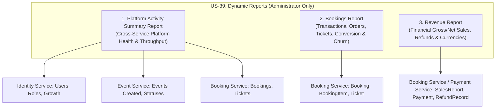

# EventPulse Dynamic Reports Specification: Metrics & Report Criteria

**Document Reference:** `EP-375`  
**Parent Epic / Feature:** `EP-59` / `US-39` — Generate Dynamic Reports  
**Target Services:** Identity Service (`eventpulse_id`), Event Service (`eventpulse_ev`), Booking Service (`eventpulse_bk`), Payment Service (`eventpulse_pm`), API Gateway (`YARP`)  
**Audience:** Software Engineers, System Architects, QA Automation Engineers, Product Owners, Business Analysts  
**Status:** Defined Baseline & Metrics Specification (Awaiting Product Owner Confirmation on Open Items)  
**Date:** October 2026 (Sprint 4)

---

## 1. Executive Summary & Objectives

User Story **US-39 (EP-59: Generate Dynamic Reports)** provides platform administrators with comprehensive, data-driven reporting to monitor platform health, sales volume, booking operational velocity, and financial reconciliation across EventPulse.

The purpose of **EP-375** is to establish the formal business rules, candidate metrics, report types, filter criteria, calculation formulas, cross-service ownership boundaries, and security policies governing dynamic reports. This specification serves as the design foundation for subsequent implementation tasks:
- **EP-376:** Backend dynamic report generation APIs.
- **EP-377:** Frontend dynamic reports dashboard, filters, and export views.
- **EP-378:** Access control hardening and administrative audit verification.

### Core Principles
1. **Match Actual EventPulse Architecture:** Definitions and formulas strictly align with current entity schemas in `eventpulse_id`, `eventpulse_ev`, `eventpulse_bk`, and `eventpulse_pm`. No hypothetical entities or database fields are invented.
2. **Preserve Service Boundaries:** In accordance with EventPulse microservice architecture, cross-service reporting must respect service autonomy and avoid direct cross-database queries.
3. **Explicit Identification of Open Decisions:** All ambiguous business questions (e.g. date dimension selection, multi-currency aggregation policies, treatment of pending holds) are documented with recommended defaults awaiting Product Owner sign-off.
4. **Documentation-Only Scope:** No application code or runtime behavior is modified in this task.

---

## 2. Baseline Architecture & Entity Inspection Findings

An exhaustive inspection of the EventPulse codebase was conducted to determine what data can be calculated reliably from the current schema.

### 2.1 Entity & Schema Inspection by Service

| Microservice | Entity / Model | Relevant Attributes | Reporting Capability |
| :--- | :--- | :--- | :--- |
| **Identity Service** (`eventpulse_id`) | `ApplicationUser` | `Id`, `Email`, `FirstName`, `LastName`, `IsActive`, `EmailConfirmed`, `ProfileCompleted`, `CreatedAt` | **Authoritative source** for user registrations, role counts (`Customer`, `Organizer`, `Administrator`), active/inactive account status. |
| | `OrganizerApplication` | `Id`, `UserId`, `Status (Pending, Approved, Rejected)`, `OrganizerName`, `OrganizerType`, `CreatedAt` | **Authoritative source** for organizer onboarding and application review volume. |
| **Event Service** (`eventpulse_ev`) | `Event` | `Id`, `OrganizerId`, `Title`, `EventDate`, `Price`, `Status (Pending=1, Approved=2, Rejected=3, Published=4, Cancelled=5)`, `CreatedAt`, `Category`, `VenueType` | **Authoritative source** for event creation counts, scheduling dates, approval lifecycle states, categories, and venue types. |
| | `TicketType` | `Id`, `EventId`, `Name`, `Price`, `Capacity`, `BookedQuantity`, `TotalQuantity`, `SoldQuantity`, `RemainingQuantity` | **Authoritative source** for total venue/ticket capacity and live inventory remaining. |
| | `EventCancellationRequest` | `Id`, `EventId`, `Status (Pending, Approved, Rejected)`, `Reason`, `CreatedAt` | Authoritative source for organizer-requested event-level cancellations. |
| **Booking Service** (`eventpulse_bk`) | `Booking` | `Id`, `BookingReference`, `CustomerId`, `EventId`, `Status (PendingPayment=1, Confirmed=2, PaymentFailed=3, Cancelled=4)`, `TotalAmount`, `CreatedAt`, `ConfirmedAt`, `ExpiresAt`, `CancelledAt`, `CancellationReason` | **Authoritative source** for booking order transactions, conversion states, and order-level cancellations. |
| | `BookingItem` | `Id`, `BookingId`, `TicketTypeId`, `TicketName`, `Quantity`, `UnitPrice`, `Subtotal` | **Authoritative source** for ticket line-item breakdowns, unit quantities, and ticket tiers. |
| | `Ticket` | `Id`, `BookingId`, `BookingItemId`, `TicketTypeId`, `TicketSequence`, `Status (Valid=1, Used=2, Cancelled=3)` | Authoritative individual attendee tickets issued and ticket validity status. |
| | `SalesReport` *(EP-383 Read Model)* | `Id`, `PaymentId`, `BookingId`, `EventId`, `OrganizerId`, `SaleAmount`, `Currency`, `PaymentTimestampUtc`, `RefundedAmount`, `RefundStatus`, `CreatedAtUtc` | Authoritative read model linking confirmed sales, revenue, refunds, and organizer/event identifiers. |
| **Payment Service** (`eventpulse_pm`) | `Payment` | `Id`, `BookingId`, `CustomerId`, `Amount`, `Currency`, `Status (Pending=0, Succeeded=1, Failed=2, Refunded=3, PartiallyRefunded=4, RefundFailed=5)`, `CreatedAt`, `CompletedAt` | **Authoritative financial ledger** for payment attempts, Stripe transaction references, and settlement timestamps. |
| | `RefundRecord` | `Id`, `PaymentId`, `BookingId`, `Amount`, `Currency`, `Status (Pending=0, Completed=1, Failed=2, NotRefundable=3)`, `CreatedAt`, `CompletedAt` | Authoritative refund audit ledger tracking individual refund transactions. |

### 2.2 Cross-Service Communication Patterns for Reports

Because EventPulse utilizes distinct microservice databases (`eventpulse_id`, `eventpulse_ev`, `eventpulse_bk`, `eventpulse_pm`), reports must be aggregated using approved architectural patterns:
1. **Synchronous Composition via HTTP Clients / API Gateway:** An administrative reporting orchestrator queries individual services via typed internal HTTP clients (`IEventAvailabilityClient`, `IIdentityClient`, `IBookingReportingClient`).
2. **Materialized Read Model / Sales Ledger:** For high-volume financial data, the existing `SalesReport` in `BookingService` already receives Kafka events (`payment-succeeded`, `payment-refunded`) and maintains pre-aggregated transactional summaries.
3. **Strict Separation of Concerns:** Identity Service does not track payments; Event Service does not store bookings; Booking Service references `EventId` and `OrganizerId` as identifiers without foreign key constraints across databases.

---

## 3. Supported Report Types

Based on the capabilities of the underlying data model, three distinct report types are defined:



### 3.1 Report Type 1: Platform Activity Summary Report
- **Purpose:** Provides a high-level executive dashboard and audit summary of platform adoption, operational throughput, and growth over a designated time period.
- **Scope:** Platform-wide (all users, all events, all bookings, all revenue).
- **Intended Audience:** Platform Administrators and Executive Leadership.
- **Key Sections:**
  1. *User Growth & Accounts Summary* (new registrations, role breakdown, active/inactive ratio).
  2. *Event Lifecycle & Inventory Summary* (events submitted, approved, published, cancelled, total venue capacity).
  3. *Booking Throughput Summary* (orders placed, confirmed orders, cancellation rate).
  4. *High-Level Financial Overview* (gross sales volume, total refunds, net platform volume by currency).

### 3.2 Report Type 2: Bookings Report
- **Purpose:** Provides deep operational visibility into ticket reservations, order conversion, ticket tier distributions, and attendee quantities.
- **Scope:** Detailed booking orders and ticket line items across all platform events, or filtered by specific event, organizer, or date range.
- **Intended Audience:** Platform Administrators and Operations Managers.
- **Key Sections:**
  1. *Booking Order Metrics* (Total Orders, Confirmed, Cancelled, In-Flight Pending, Failed).
  2. *Ticket Volume Metrics* (Total Tickets, Active Valid Tickets, Cancelled Tickets, Average Tickets per Booking).
  3. *Order Conversion & Cancellation Rates* (Checkout Success %, Order Cancellation %, Ticket Churn %).
  4. *Per-Event Booking Performance Table* (Order volume, ticket count, capacity utilization % per event).
  5. *Ticket Tier Breakdown* (VIP, General Admission distribution across selected events).

### 3.3 Report Type 3: Revenue Report
- **Purpose:** Delivers accurate financial reconciliation of gross sales, customer refunds, net platform proceeds, and currency distributions.
- **Scope:** Completed financial transactions and adjustments recorded across Payment and Booking services.
- **Intended Audience:** Platform Administrators, Finance Officers, and Compliance Auditors.
- **Key Sections:**
  1. *Executive Financial Totals* (Gross Revenue, Total Refunded Amount, Net Revenue).
  2. *Currency Breakdown* (Segregated totals for USD, LKR, and any other supported currency without mixing).
  3. *Per-Event Revenue Table* (Gross sales, refunds, net revenue, purchase count per event).
  4. *Per-Organizer Revenue Breakdown* (Revenue generated per organizer account).
  5. *Refund & Adjustment Audit* (Complete refund counts, partial refund sums, refund failure tracking).

---

## 4. Candidate Metrics & Formal Definitions

### 4.1 Platform & User Metrics (`eventpulse_id`)

| Metric Code | Metric Name | Definition & Formula | Underlying Entities |
| :--- | :--- | :--- | :--- |
| `USR-01` | **Total Registered Users** | Total count of unique `ApplicationUser` records created on or before the filter boundary. | `ApplicationUser.Id` |
| `USR-02` | **New User Registrations** | Count of users registered strictly within the reporting window: $\sum [ \text{from} \le \text{CreatedAt} \le \text{to} ]$. | `ApplicationUser.CreatedAt` |
| `USR-03` | **Users by Role** | Segmentation of registered users by assigned role: $\text{Count}(\text{Customer})$, $\text{Count}(\text{Organizer})$, $\text{Count}(\text{Administrator})$. | `AspNetUserRoles`, `AppRoles` |
| `USR-04` | **Active vs. Inactive Accounts** | Count of accounts where `IsActive == true` vs `IsActive == false` (administrative suspension). | `ApplicationUser.IsActive` |
| `USR-05` | **Email Verification Rate** | Percentage of registered users with confirmed email: $\frac{\text{Count}(\text{EmailConfirmed} = \text{true})}{\text{Total Registered Users}} \times 100\%$. | `ApplicationUser.EmailConfirmed` |
| `USR-06` | **Pending Organizer Applications** | Count of organizer upgrade applications currently in `Pending` review state. | `OrganizerApplication.Status` |

### 4.2 Event Lifecycle & Inventory Metrics (`eventpulse_ev`)

| Metric Code | Metric Name | Definition & Formula | Underlying Entities |
| :--- | :--- | :--- | :--- |
| `EVT-01` | **Total Events Created** | Count of all events submitted to the platform within the reporting period: $\sum [ \text{from} \le \text{CreatedAt} \le \text{to} ]$. | `Event.Id`, `Event.CreatedAt` |
| `EVT-02` | **Events by Status** | Count of events grouped by authoritative lifecycle status: `Pending (1)`, `Approved (2)`, `Rejected (3)`, `Published (4)`, `Cancelled (5)`. | `Event.Status` |
| `EVT-03` | **Active / Published Events** | Count of events currently visible to customers with `Status == EventStatus.Published`. | `Event.Status` |
| `EVT-04` | **Events by Category** | Distribution of events by category (e.g. *Musical Concert*, *Conference*, *Workshop*, *Sports*). | `Event.Category` |
| `EVT-05` | **Events by Venue Environment** | Breakdown of events by venue type (*Indoor* vs *Outdoor*). | `Event.VenueType` |
| `EVT-06` | **Total Platform Capacity** | Sum of maximum ticket capacities across all published events: $\sum \text{TicketType.Capacity}$. | `TicketType.Capacity` |
| `EVT-07` | **Remaining Inventory** | Sum of unreserved tickets across all published events: $\sum \text{TicketType.RemainingQuantity}$. | `TicketType.RemainingQuantity` |

### 4.3 Booking & Ticket Volume Metrics (`eventpulse_bk`)

| Metric Code | Metric Name | Definition & Formula | Underlying Entities |
| :--- | :--- | :--- | :--- |
| `BKG-01` | **Total Booking Orders** | Total completed checkout orders (confirmed + cancelled): $\text{Confirmed} + \text{Cancelled}$. Excludes in-flight pending holds and failed checkouts. | `Booking.Status` |
| `BKG-02` | **Confirmed Bookings** | Current active orders with `Status == BookingStatus.Confirmed` and successful payment. | `Booking.Status`, `ConfirmedAt` |
| `BKG-03` | **Cancelled Bookings** | Orders with `Status == BookingStatus.Cancelled` that were previously confirmed and subsequently cancelled. | `Booking.Status`, `CancelledAt` |
| `BKG-04` | **Total Tickets Sold (Gross)** | Total ticket units purchased across all orders prior to cancellations: $\sum_{\text{Orders}} \sum \text{BookingItem.Quantity}$. | `BookingItem.Quantity` |
| `BKG-05` | **Active Tickets Booked** | Total ticket units currently valid for admission: $\sum_{\text{Confirmed Orders}} \sum \text{BookingItem.Quantity}$. | `BookingItem.Quantity`, `Ticket.Status` |
| `BKG-06` | **Cancelled Tickets** | Total ticket units voided due to cancellations: $\sum_{\text{Cancelled Orders}} \sum \text{BookingItem.Quantity}$. | `BookingItem.Quantity`, `Ticket.Status` |
| `BKG-07` | **Booking Cancellation Rate** | Percentage of completed orders that were cancelled: $\frac{\text{Cancelled Bookings}}{\text{Total Booking Orders}} \times 100\%$. | `Booking.Status` |
| `BKG-08` | **Ticket Cancellation Rate** | Percentage of ticket units that were voided: $\frac{\text{Cancelled Tickets}}{\text{Gross Tickets Sold}} \times 100\%$. | `BookingItem.Quantity` |
| `BKG-09` | **Average Tickets Per Booking** | Average ticket units per confirmed order: $\frac{\text{Active Tickets Booked}}{\text{Confirmed Bookings}}$. | `BookingItem.Quantity`, `Booking.Status` |
| `BKG-10` | **Pending Payment Reservations** | Temporary 15-minute checkout holds currently in `Status == BookingStatus.PendingPayment`. | `Booking.Status`, `ExpiresAt` |
| `BKG-11` | **Payment Failed Orders** | Abandoned or rejected checkout attempts: `Status == BookingStatus.PaymentFailed`. | `Booking.Status` |
| `BKG-12` | **Capacity Utilization Rate** | Percentage of platform ticket capacity sold: $\frac{\text{Active Tickets Booked}}{\text{Total Platform Capacity}} \times 100\%$. | `BookingItem.Quantity`, `TicketType.Capacity` |

### 4.4 Financial & Revenue Metrics (`eventpulse_bk` / `eventpulse_pm`)

| Metric Code | Metric Name | Definition & Formula | Underlying Entities |
| :--- | :--- | :--- | :--- |
| `REV-01` | **Gross Revenue** | Total monetary volume captured from successful checkouts prior to refunds: $\sum \text{SalesReport.SaleAmount}$. | `SalesReport.SaleAmount`, `Payment.Amount` |
| `REV-02` | **Refunded Amount** | Cumulative monetary amount refunded to customers for cancelled or adjusted bookings: $\sum \text{SalesReport.RefundedAmount}$. | `SalesReport.RefundedAmount`, `RefundRecord.Amount` |
| `REV-03` | **Net Revenue** | Actual retained monetary volume: $\text{Gross Revenue} - \text{Refunded Amount}$. | `SalesReport`, `Payment` |
| `REV-04` | **Successful Purchase Count** | Total count of completed, successful customer payment transactions: $\text{Count}(\text{SalesReport.Id})$. | `SalesReport.Id`, `Payment.Id` |
| `REV-05` | **Average Order Value (AOV)** | Average monetary gross value per successful purchase: $\frac{\text{Gross Revenue}}{\text{Successful Purchase Count}}$. | `SalesReport.SaleAmount` |
| `REV-06` | **Currency-Segregated Revenue** | Gross, refunded, and net amounts grouped strictly by ISO currency code (`USD`, `LKR`). | `SalesReport.Currency` |
| `REV-07` | **Refund Rate (%)** | Monetary refund percentage of gross volume: $\frac{\text{Refunded Amount}}{\text{Gross Revenue}} \times 100\%$. | `SalesReport` |
| `REV-08` | **Full vs. Partial Refund Count** | Segregation of refunds where `RefundStatus == Refunded` (100% refund) vs `PartiallyRefunded` (partial ticket refund). | `SalesReport.RefundStatus`, `Payment.Status` |

---

## 5. Supported Filter Criteria

Dynamic reports must support flexible, multi-dimensional filtering strictly constrained by fields available in the current data model:

```
┌─────────────────────────────────────────────────────────────────────────────┐
│                       SUPPORTED REPORT FILTER CRITERIA                      │
├─────────────────────────────────────────────────────────────────────────────┤
│ 1. Date Range:         from (ISO-8601 UTC)  to (ISO-8601 UTC)                │
│ 2. Event Scope:        All Events | Specific EventId (GUID)                 │
│ 3. Organizer Scope:    All Organizers | Specific OrganizerId (GUID)         │
│ 4. Booking Status:     All | Confirmed | Cancelled | PendingPayment | Failed│
│ 5. Event Status:       All | Published | Approved | Pending | Cancelled     │
│ 6. Currency Filter:    All (Segregated) | USD | LKR                         │
│ 7. Category Filter:    All | Musical Concert | Conference | Sports | etc.   │
│ 8. Venue Type:         All | Indoor | Outdoor                               │
│ 9. User Role:          All | Customer | Organizer | Administrator           │
└─────────────────────────────────────────────────────────────────────────────┘
```

### 5.1 Filter Specification Table

| Filter Name | Parameter Key | Data Type | Permitted Values | Supported Report Types |
| :--- | :--- | :--- | :--- | :--- |
| **Date Range (From)** | `from` | `DateTimeOffset` (ISO-8601) | Valid UTC timestamp (e.g. `2026-10-01T00:00:00Z`). Defaults to beginning of current month if omitted. | All Reports |
| **Date Range (To)** | `to` | `DateTimeOffset` (ISO-8601) | Valid UTC timestamp (e.g. `2026-10-31T23:59:59.999Z`). Defaults to current UTC timestamp if omitted. | All Reports |
| **Event Filter** | `eventId` | `Guid?` | Valid Event GUID or `null` (All Events). | Bookings Report, Revenue Report |
| **Organizer Filter** | `organizerId` | `Guid?` | Valid Organizer User GUID or `null` (All Organizers). | Bookings Report, Revenue Report |
| **Booking Status** | `bookingStatus` | `string?` | `All`, `Confirmed`, `Cancelled`, `PendingPayment`, `PaymentFailed`. | Bookings Report |
| **Event Status** | `eventStatus` | `string?` | `All`, `Pending`, `Approved`, `Published`, `Cancelled`, `Rejected`. | Platform Activity, Bookings |
| **Currency** | `currency` | `string?` | ISO-4217 code (`USD`, `LKR`) or `null` (multi-currency breakdown). | Revenue Report, Platform Activity |
| **Event Category** | `category` | `string?` | Event category string (from `EventCategories.All`). | Platform Activity, Bookings |
| **Venue Type** | `venueType` | `string?` | `Indoor`, `Outdoor`, or `null`. | Platform Activity |
| **User Role** | `role` | `string?` | `All`, `Customer`, `Organizer`, `Administrator`. | Platform Activity (Users section) |

---

## 6. Calculation Rules & Edge Cases

### 6.1 Date Boundary Rules & Timezone Handling
1. **Universal UTC Time:** All date and time calculations must operate strictly in UTC (`DateTimeOffset.UtcNow`). No server-local or client-local offsets may be applied during aggregation.
2. **Inclusive Boundaries:** Both `from` and `to` filters are inclusive:
   $$\text{Filter Condition} \iff \text{from} \le \text{Timestamp} \le \text{to}$$
3. **Date Boundary Normalization:** When client submits date-only parameters (e.g. `from=2026-10-01&to=2026-10-15`):
   - `from` normalizes to `2026-10-01T00:00:00.0000000Z`.
   - `to` normalizes to `2026-10-15T23:59:59.9999999Z`.
4. **Validation Constraints:** If `from > to`, the API must reject the request with HTTP `400 Bad Request` (`DATE_RANGE_INVALID: "The start date must be earlier than or equal to the end date."`).

### 6.2 Primary Timestamp Dimensions Across Entities
Because different entities record multiple lifecycle timestamps, calculation rules must specify the exact field evaluated for date range filtering:

| Entity | Primary Reporting Timestamp | Rationale |
| :--- | :--- | :--- |
| `ApplicationUser` | `CreatedAt` | Captures registration date. |
| `Event` | `CreatedAt` | Captures creation date. *(Optional secondary filter on `EventDate` for event occurrence).* |
| `Booking` (Bookings Report) | `ConfirmedAt ?? CreatedAt` | Evaluates when booking completed checkout. Cancelled bookings retain original `ConfirmedAt` to preserve purchase period. |
| `SalesReport` (Revenue Report) | `PaymentTimestampUtc` | Authoritative settlement timestamp from Payment Service/Stripe webhook. |
| `RefundRecord` / Adjustments | `RefundTimestampUtc` / `CompletedAt` | Evaluates when the refund was processed. |

### 6.3 Treatment of In-Flight, Failed, and Abandoned Checkouts
1. **`BookingStatus.PendingPayment`:**
   - Represents a temporary 15-minute checkout reservation hold.
   - **Must NOT** be counted as Gross Revenue or Net Revenue.
   - **Must NOT** be counted as Active Tickets Booked.
   - May be reported separately in Bookings Report under operational diagnostic metric `Pending Payment Holds`.
2. **`BookingStatus.PaymentFailed`:**
   - Represents a failed or abandoned Stripe checkout attempt.
   - **Must NOT** be counted as Revenue or Active Tickets.
   - Tracked in Bookings Report as diagnostic conversion loss metric `Failed Checkout Attempts`.

### 6.4 Cancelled Bookings & Refund Calculations
1. **Booking Cancellation without Refund:**
   - Booking transitions to `BookingStatus.Cancelled`.
   - Tickets transition to `TicketStatus.Cancelled`.
   - `ActiveTicketsBooked` decreases by the cancelled quantity.
   - If no refund was issued (e.g. zero-amount ticket or non-refundable window expired), `RefundedAmount = 0`, so `NetRevenue` remains unchanged.
2. **Booking Cancellation with Full Refund:**
   - `BookingStatus` = `Cancelled`.
   - `SalesReport.RefundedAmount` = `SaleAmount`.
   - `SalesReport.RefundStatus` = `Refunded`.
   - `GrossRevenue` remains unchanged (reflects historical purchase volume).
   - `RefundedAmount` increments by refund amount.
   - `NetRevenue` decreases to `0.00`.
3. **Partial Refund (Ticket-Level Cancellation):**
   - When 1 out of 3 tickets is cancelled, `SalesReport.RefundedAmount` increments by the unit price of the refunded ticket.
   - `SalesReport.RefundStatus` = `PartiallyRefunded`.
   - $\text{Net Revenue} = \text{SaleAmount} - \text{RefundedAmount} > 0$.
   - Active tickets count decreases by 1; booking order remains valid.

### 6.5 Multi-Currency Reconciliation Policy
1. **Strict Currency Isolation:** EventPulse currently supports multi-currency sales (`USD`, `LKR`). Because no automated real-time currency conversion feed is approved:
   - **Reports must NEVER sum amounts across different currencies into a single number.**
   - Totaling `1,000 LKR + $100 USD = 1,100` is strictly prohibited.
2. **Currency Presentation Rule:**
   - Financial reports must return a segregated collection of currency totals:
     ```json
     "currencyBreakdown": [
       { "currency": "USD", "grossRevenue": 450.00, "refundedAmount": 50.00, "netRevenue": 400.00 },
       { "currency": "LKR", "grossRevenue": 150000.00, "refundedAmount": 0.00, "netRevenue": 150000.00 }
     ]
     ```
   - When filtered by a specific currency (`currency=USD`), the root financial summary reflects that currency alone.

### 6.6 Empty Results & Zero Value Handling
1. **No Data / Empty Period:** When a query matches zero records:
   - Numerical metrics must return `0` (or `0.00` for currency). Never return `null`, `NaN`, or omit the field.
   - Rates (`CancellationRate`, `UtilizationRate`) must return `0.0` (never divide-by-zero).
   - Array fields (`items`, `currencyBreakdown`, `ticketTypes`) must return empty arrays `[]`, never `null`.
   - The API must return HTTP `200 OK` with an empty data structure, not `404 Not Found`.

---

## 7. Security, Access Control & Authorization

Dynamic reports expose platform-wide financial figures, attendee volumes, and user metrics. Strict access controls must be enforced:

### 7.1 Required Permissions & Role Policies
- **Role Requirement:** `Administrator` only (`[Authorize(Policy = AppPolicies.AdminOnly)]`).
- **Customer Role:** Requests from authenticated customers must be rejected with HTTP `403 Forbidden`.
- **Organizer Role:** Requests from event organizers must be rejected with HTTP `403 Forbidden`. (Organizers possess access strictly to their own scoped analytics under `EP-60` and `EP-61`, never platform-wide reports).
- **Anonymous / Unauthenticated:** Unauthenticated requests must return HTTP `401 Unauthorized`.

### 7.2 API Gateway Configuration (`YARP`)
- Routes for administrative reporting will be mapped through the API Gateway under:
  - `Match: { "Path": "/api/admin/reports/{**catch-all}" }`
- Gateway enforces CORS policy `AllowFrontend` and forwards claims principal containing `Role: Administrator` to the backend cluster.

### 7.3 Data Privacy & PII Protection
- Summary and aggregated reports must **never leak individual customer PII**:
  - Exclude customer passwords, salt hashes, security stamps, lockout counts, and verification tokens.
  - Exclude customer credit card numbers, Stripe session tokens, and Stripe client secrets.
  - Aggregate reports present counts, sums, and percentages, not customer identity dumps.

---

## 8. Open Assumptions Requiring Product Owner Confirmation

In accordance with EP-375 requirements, ambiguous business rules and architectural choices that require formal Product Owner sign-off are cataloged below:

| # | Topic / Question | Option A | Option B | Recommended Decision |
| :--- | :--- | :--- | :--- | :--- |
| **PO-1** | **Primary Date Dimension for Revenue Filtering** | **Date of Payment (`PaymentTimestampUtc`):** Reflects actual cash flow and financial settlement timing. | **Date of Event (`EventDate`):** Reflects revenue earned by event occurrence date (accrual accounting). | **Option A (Date of Payment):** Standard for e-commerce and Stripe reporting; aligns with existing `SalesReport` model. |
| **PO-2** | **Multi-Currency Reporting Presentation** | **Strict Currency Segregation:** Display separate financial cards and tables for USD and LKR without converting. | **Unified Base Currency Conversion:** Convert all currencies to USD using a fixed or configurable exchange rate. | **Option A (Strict Segregation):** Prevents misleading financial totals until a verified daily FX rate service is integrated. |
| **PO-3** | **Handling of "Pending Payment" in Bookings Count** | **Exclude from Total Bookings:** Count only completed orders (`Confirmed + Cancelled`). | **Include as a Sub-status:** Count all checkouts initiated, showing pending as an active state. | **Option A (Exclude):** Aligns with approved `EP-388` rule where pending holds are treated as in-flight cart operations. |
| **PO-4** | **Definition of "Active Users" in Platform Summary** | **Account Status Flag (`IsActive == true`):** Accounts not suspended by an administrator. | **Activity-Based:** Users who logged in or placed a booking within the last 30/90 days. | **Option A for now:** Supported directly by `ApplicationUser.IsActive`. (Activity-based requires login audit logging not yet present). |
| **PO-5** | **Handling of Seeded Test Data in Reports** | **Include all database records:** Reports reflect entire database as-is. | **Filter out seeded test accounts/events:** Exclude accounts with `@eventpulse.lk` domain from public platform reports. | **Option B for Production / Option A for Local Dev:** PO to confirm whether a test-data exclusion toggle is required. |
| **PO-6** | **Reporting Delivery Mechanism** | **Synchronous REST API:** Dynamic JSON payloads rendered into frontend interactive tables and charts. | **Asynchronous File Export:** Background queue generating downloadable CSV or PDF reports. | **Option A for EP-376 / EP-377**, with CSV export as a secondary enhancement. |

---

## 9. Summary & Next Steps (Implementation Roadmap)

This specification defines the complete requirements for dynamic reports under **US-39**:

1. **EP-375 (This Task):** Define metrics, report criteria, calculation rules, and open assumptions in project documentation.
2. **EP-376 (Next Backend Task):** Implement backend report query services and REST controllers under `/api/admin/reports` with `[Authorize(Policy = AppPolicies.AdminOnly)]`.
3. **EP-377 (Next Frontend Task):** Implement admin dynamic reports dashboard, filters, cards, and tables in the React frontend.
4. **EP-378 (Next Security Task):** Enforce access control verification, audit logging, and automated test coverage across all report endpoints.
