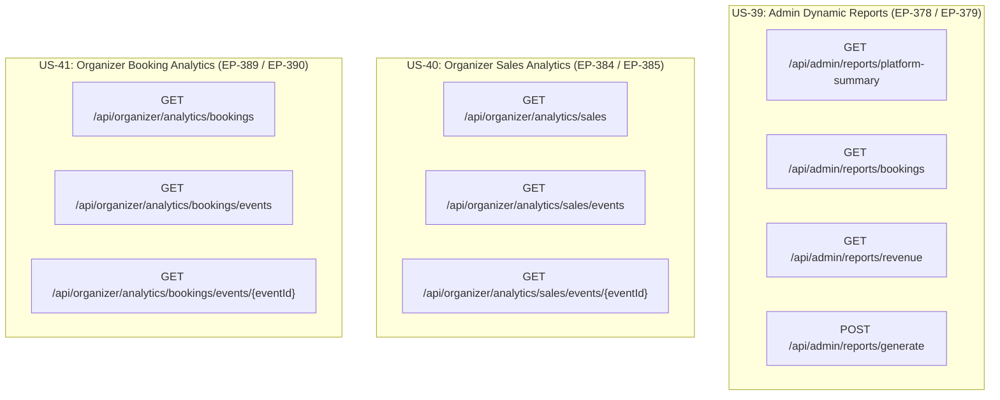
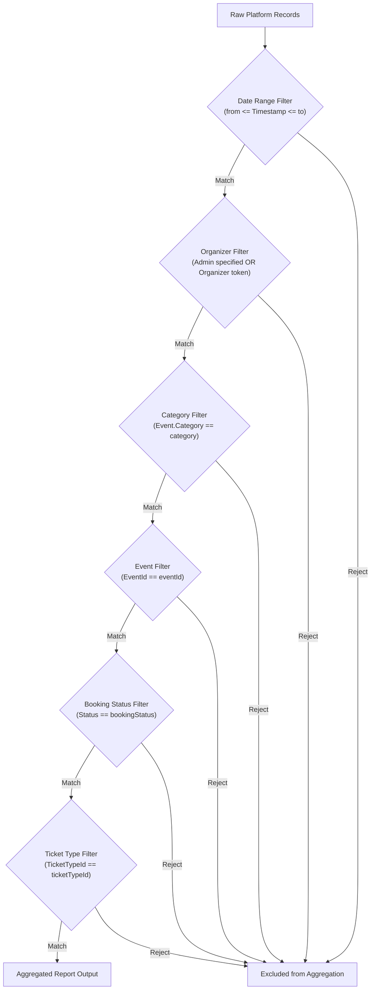

# EventPulse Report Filtering Specification: Supported Filters & Business Rules

**Document Reference:** `EP-393`  
**Parent Epic / Feature:** `US-42` — Filter Reports (Intersecting `US-39` Dynamic Reports, `US-40` Sales Analytics, and `US-41` Booking Analytics)  
**Target Services:** Booking Service (`eventpulse_bk`), Event Service (`eventpulse_ev`), Payment Service (`eventpulse_pm`), Identity Service (`eventpulse_id`), API Gateway (`YARP`), Frontend Application  
**Audience:** Software Engineers, System Architects, QA Automation Engineers, Product Owners, Business Analysts  
**Status:** Defined Specification (Baseline Filter Rules & Open Product Owner Decisions)  
**Date:** October 2026 (Sprint 4)

---

## 1. Executive Summary & Purpose

The purpose of **EP-393** is to define the formal architectural specification, filtering rules, role-based access controls, default states, validation constraints, and calculation impacts for report filtering across the EventPulse platform.

EventPulse currently provides three major analytical systems:
1. **US-39: Dynamic Reports (EP-59):** Platform-wide operational, booking, and financial reporting for platform Administrators (`platform-summary`, `bookings`, `revenue`).
2. **US-40: Sales Analytics (EP-60):** Monetary performance, gross sales, refunds, net revenue, and currency breakdowns for Event Organizers.
3. **US-41: Booking Analytics (EP-61):** Operational order volumes, ticket quantities, cancellation churn, and venue capacity saturation for Event Organizers.

Under **US-42 (Filter Reports)**, users must be able to filter analytical metrics to derive actionable insights without compromising system performance, security boundaries, multi-tenant isolation, or financial reconciliation integrity.

### Core Principles
1. **Multi-Tenant Data Isolation:** Organizers must never be capable of filtering or observing data belonging to other organizers. All organizer queries must strictly scope to their authenticated `OrganizerId`.
2. **Deterministic Multi-Filter Logic:** Filter criteria combine strictly using boolean `AND` (intersection) logic unless an explicit business rule mandates alternative aggregation.
3. **Graceful Zero-Handling:** Empty filtered result sets must return zero-valued metrics ($0.00 sums, 0 counts) rather than throwing HTTP 404, 500, or empty null responses.
4. **Authoritative Server-Side Validation:** The backend remains the sole authority for data filtering, role authorization, and validation. Client-side validation serves only as an immediate UX enhancement.
5. **Separation of Specification from Implementation:** In accordance with task requirements, this document formalizes all rules and open questions before code changes are introduced.

---

## 2. Baseline Architecture & Existing Report Inspection

An inspection of the codebase, existing reporting controllers, data models, and services was conducted across all three analytics user stories.

### 2.1 Existing Report Types & Endpoints Summary



| User Story | Scope | Audience | Existing Endpoints | Current Available Filters |
| :--- | :--- | :--- | :--- | :--- |
| **US-39: Dynamic Reports** | Platform-Wide | Administrator Only | `GET /api/admin/reports/platform-summary`<br/>`GET /api/admin/reports/bookings`<br/>`GET /api/admin/reports/revenue`<br/>`POST /api/admin/reports/generate` | Date Range (`from`, `to`), `eventId`, `organizerId`, `bookingStatus` (Bookings), `currency` (Revenue) |
| **US-40: Sales Analytics** | Organizer Portfolio | Organizer Only | `GET /api/organizer/analytics/sales`<br/>`GET /api/organizer/analytics/sales/events`<br/>`GET /api/organizer/analytics/sales/events/{eventId}` | Date Range (`from`, `to`), Title Search (`search`), Event ID route parameter (`eventId`) |
| **US-41: Booking Analytics** | Organizer Portfolio | Organizer Only | `GET /api/organizer/analytics/bookings`<br/>`GET /api/organizer/analytics/bookings/events`<br/>`GET /api/organizer/analytics/bookings/events/{eventId}` | Date Range (`from`, `to`), Title Search (`search`), Event ID route parameter (`eventId`) |

### 2.2 Cross-Service Data Ownership & Storage Locations

Because EventPulse utilizes decoupled microservice databases, filter attributes are partitioned across services:

| Filter Attribute | Authoritative Source Service | Database Table / Entity | Cross-Service Considerations |
| :--- | :--- | :--- | :--- |
| **Date Range** | Booking Service (`eventpulse_bk`)<br/>Payment Service (`eventpulse_pm`) | `Bookings.ConfirmedAt`<br/>`SalesReports.PaymentTimestampUtc` | Authoritative timestamps exist directly within reporting data models in `BookingService`. |
| **Event ID** | Booking Service / Event Service | `Bookings.EventId`<br/>`Events.Id` | Direct foreign identifier stored in `Booking` and `SalesReport`. |
| **Organizer ID** | Event Service (`eventpulse_ev`)<br/>Booking Service (`eventpulse_bk`) | `Events.OrganizerId`<br/>`SalesReports.OrganizerId` | Stored in `SalesReport` read model. In `Booking` table, requires mapping via `EventId` -> `OrganizerId`. |
| **Booking Status** | Booking Service (`eventpulse_bk`) | `Bookings.Status` | Native enum on `Booking` entity: `PendingPayment(1)`, `Confirmed(2)`, `PaymentFailed(3)`, `Cancelled(4)`. |
| **Ticket Type ID** | Booking Service / Event Service | `BookingItems.TicketTypeId`<br/>`TicketTypes.Id` | Exists on line-item child entity `BookingItem` and individual `Ticket` records. |
| **Category** | Event Service (`eventpulse_ev`) | `Events.Category` | Stored strictly in Event Service (`EventCategories.All`). Cross-service resolution required for booking/revenue queries. |
| **Currency** | Payment Service / Booking Service | `SalesReports.Currency`<br/>`Payments.Currency` | ISO 4217 code stored in `SalesReport` and `Payment` records. |
| **Venue Type** | Event Service (`eventpulse_ev`) | `Events.VenueType` | Stored in Event Service (`Indoor`, `Outdoor`). |

---

## 3. Supported Filters Catalog & Definitions

Based on application requirements and existing entity capabilities, the following six core filters and two extended filters are formally defined:

### 3.1 Core Filters

#### 1. Date Range Filter (`from` and `to`)
- **Description:** Restricts reporting metrics to records where the primary timestamp falls within the inclusive interval $[\text{from}, \text{to}]$.
- **Data Type:** UTC ISO-8601 strings (`DateTimeOffset` in C#).
- **Primary Timestamps Evaluated:**
  - *Booking Metrics:* `Booking.ConfirmedAt` (or `Booking.CreatedAt` for pending/failed attempts).
  - *Sales & Revenue Metrics:* `SalesReport.PaymentTimestampUtc`.
  - *Cancellations / Refunds:* `Booking.CancelledAt` / `RefundRecord.CompletedAt`.
- **Supported Presets:**
  - `allTime`: Unbounded historical range (or platform inception to now).
  - `today`: Start of current UTC day to end of current UTC day.
  - `last7Days`: Now minus 7 days to current timestamp.
  - `last30Days`: Now minus 30 days to current timestamp.
  - `thisMonth`: First day of current UTC month (`YYYY-MM-01T00:00:00Z`) to current timestamp.
  - `lastQuarter`: Now minus 90 days to current timestamp.
- **Constraints:**
  - $\text{from} \le \text{to}$.
  - Maximum span: **730 days (2 years)**.

#### 2. Event Filter (`eventId`)
- **Description:** Filters metrics for a single designated event or evaluates all accessible events.
- **Data Type:** `Guid?` (UUID v4 format).
- **Values:** Valid Event UUID, or `null` / `"ALL"` representing all events within the user's authorized scope.
- **Scope Rule:** For Organizers, the event must be verified as owned by the authenticated organizer.

#### 3. Booking Status Filter (`bookingStatus`)
- **Description:** Filters booking order throughput by order lifecycle state.
- **Data Type:** `string?` / `enum`.
- **Allowed Values:**
  - `All`: Includes all completed orders (Confirmed + Cancelled).
  - `Confirmed`: Valid, paid orders currently active.
  - `Cancelled`: Formerly confirmed orders that were subsequently cancelled.
  - `PendingPayment`: Unsettled 15-minute checkout reservation holds.
  - `PaymentFailed`: Rejected or abandoned checkout attempts.

#### 4. Ticket Type Filter (`ticketTypeId`)
- **Description:** Narrows ticket quantity and line-item financial distribution to a specific ticket tier (e.g., *VIP*, *General Admission*, *Early Bird*).
- **Data Type:** `Guid?` (UUID v4 format).
- **Dependency Rule:** Must be paired with a valid `eventId`, as ticket types are child entities belonging exclusively to a specific event.

#### 5. Category Filter (`category`)
- **Description:** Aggregates metrics across events belonging to a designated canonical category.
- **Data Type:** `string?`.
- **Allowed Values (Canonical):**
  - `Music`
  - `Sports`
  - `Conference`
  - `Workshop`
  - `Festival`
  - `Arts & Theatre`
  - `Community`
  - `Other`
- **Legacy Alias Normalization:** Inputs matching legacy aliases (e.g. `"Musical Concert"` $\to$ `"Music"`, `"Theatre / Performance"` $\to$ `"Arts & Theatre"`) are automatically mapped via `EventCategories.Normalize()`.
- **Cross-Service Resolution Rule:** When `category` is specified, the reporting engine queries Event Service for all `EventId`s where `Category == category`, and filters the Booking Service dataset by `eventId IN (resolvedIds)`.

#### 6. Organizer Filter (`organizerId`) — Administrators Only
- **Description:** Filters platform-wide dynamic reports to reflect activity generated by a specific organizer.
- **Data Type:** `Guid?` (UUID v4 format).
- **Authorization Constraint:** **Strictly Administrator Only.** Never exposed or accepted for Organizer requests.

### 3.2 Extended Filters

#### 7. Currency Filter (`currency`)
- **Description:** Isolates monetary financial totals by ISO 4217 currency code.
- **Allowed Values:** `ALL` (Segregated multi-currency cards), `USD`, `LKR`.

#### 8. Venue Type Filter (`venueType`)
- **Description:** Filters events and derived throughput by environmental venue classification.
- **Allowed Values:** `All`, `Indoor`, `Outdoor`.

---

## 4. Role-Based Filter Permissions Matrix & Multi-Tenant Isolation

### 4.1 Permission Matrix by User Role

| Filter Parameter | Administrator (US-39) | Organizer (US-40 / US-41) | Customer | Logged-Out Visitor |
| :--- | :--- | :--- | :--- | :--- |
| **Date Range (`from`, `to`)** | Allowed (Platform-wide) | Allowed (Own events only) | Prohibited | Prohibited |
| **Event (`eventId`)** | Allowed (Any event) | Allowed (Own events only) | Prohibited | Prohibited |
| **Booking Status (`bookingStatus`)** | Allowed (All statuses) | Allowed (Own bookings) | Prohibited | Prohibited |
| **Ticket Type (`ticketTypeId`)** | Allowed (Any event's tier) | Allowed (Own event's tier)| Prohibited | Prohibited |
| **Category (`category`)** | Allowed (All events) | Allowed (Own events) | Prohibited | Prohibited |
| **Organizer (`organizerId`)** | **Allowed (Any organizer)** | **Prohibited (Forbidden)**| Prohibited | Prohibited |
| **Currency (`currency`)** | Allowed (USD, LKR, ALL) | Fixed / Isolated | Prohibited | Prohibited |
| **Title Search (`search`)** | N/A (Direct UUID / Dropdown) | Allowed (Own events list) | Prohibited | Prohibited |

### 4.2 Multi-Tenant Data Isolation Rules for Organizers

1. **Server-Authoritative Identity:** The backend must extract the organizer's identifier strictly from verified JWT claims (`ClaimTypes.NameIdentifier` or `"sub"`). A client-supplied organizer ID query parameter must **never** be trusted.
2. **Rejection of Client `organizerId`:** If an organizer client passes `?organizerId=...`, the backend must either:
   - Reject the request with HTTP `400 Bad Request` (`PROHIBITED_FILTER: "Organizers cannot supply an organizerId filter."`), or
   - Silently force the filter value to match the authenticated organizer's identity.
3. **Event Ownership Verification:**
   - When an organizer requests metrics filtered by `eventId`, the service must verify that `Event.OrganizerId == AuthenticatedOrganizerId`.
   - If the event exists but is owned by a different organizer, the API must return **HTTP `404 Not Found`** (rather than 403) to prevent malicious actors from determining the existence of other organizers' private event IDs (enumeration defense).
4. **Ticket Type Ownership Verification:**
   - When an organizer filters by `ticketTypeId`, the service must verify that the ticket type belongs to an event owned by that organizer.

---

## 5. Filter Combination Logic (AND Evaluation)

### 5.1 Universal Boolean Intersection

All active filters combine strictly using **boolean `AND`** logic. For any record to be included in an aggregated report calculation, it must satisfy all active filter predicates simultaneously:

$$\text{Included Record} \iff \mathcal{P}_{\text{Date}} \land \mathcal{P}_{\text{Event}} \land \mathcal{P}_{\text{Status}} \land \mathcal{P}_{\text{Category}} \land \mathcal{P}_{\text{TicketType}} \land \mathcal{P}_{\text{Organizer}}$$



### 5.2 Filter Dependency Rules

| Filter Combination | Validity | Enforcement Behavior |
| :--- | :--- | :--- |
| **`eventId` + Date Range** | **Valid** | Filters bookings/sales for that specific event within the date range. |
| **`category` + Date Range** | **Valid** | Resolves all events in the category, then aggregates their metrics within the date range. |
| **`category` + `eventId`** | **Conditional** | If the specified event belongs to the specified category $\to$ Valid.<br/>If the specified event belongs to a *different* category $\to$ Returns empty zero-valued result (AND logic contradiction). |
| **`ticketTypeId` without `eventId`** | **Invalid** | Returns HTTP `400 Bad Request` (`INVALID_FILTER_DEPENDENCY: "A valid eventId must be provided when filtering by ticketTypeId."`). |
| **`ticketTypeId` + mismatched `eventId`**| **Invalid** | If `ticketTypeId` does not belong to `eventId` $\to$ Returns HTTP `400 Bad Request` (`TICKET_TYPE_NOT_FOUND_FOR_EVENT`). |
| **`organizerId` + `eventId` (Admin)** | **Conditional** | If event belongs to organizer $\to$ Valid.<br/>If event belongs to different organizer $\to$ Returns zero-valued result. |

---

## 6. Default Filter Values & "Clear Filters" Lifecycle

### 6.1 Default Filter States

When a user opens any reporting or analytics screen, filters must initialize to predictable, agreed default values:

| Filter Parameter | Default Value (Admin Reports) | Default Value (Organizer Analytics) | Rationale |
| :--- | :--- | :--- | :--- |
| **Date Range** | `allTime` (Unbounded lifetime) | `allTime` (or `last30Days` if scoped) | Ensures administrators immediately see lifetime totals without missing older data. |
| **Event** | `All Events` (`null`) | `All Events` (`"ALL"`) | Presents the complete portfolio overview before drilldown. |
| **Category** | `All Categories` (`null`) | `All Categories` (`null`) | Does not restrict events by genre by default. |
| **Booking Status** | `All` (Completed orders) | `All` (Confirmed + Cancelled) | Reflects total historical conversion volume. |
| **Ticket Type** | `All Ticket Types` (`null`) | `All Ticket Types` (`null`) | Summarizes across all tiers until drilldown. |
| **Organizer** | `All Organizers` (`null`) | Implicitly fixed to token identity | Scopes platform-wide for admin; scopes to tenant for organizer. |
| **Currency** | `ALL` (Segregated breakdown) | Fixed to event/portfolio currency | Displays multi-currency cards without mixing currencies. |

### 6.2 "Clear Filters" (Reset) Lifecycle

When the user triggers the "Clear Filters" or "Reset to Default" action:
1. **Reset Values:**
   - Date range resets to `allTime` (`from = ""`, `to = ""`).
   - `eventId` resets to `null` / `"ALL"`.
   - `category` resets to `null` / `"ALL"`.
   - `bookingStatus` resets to `"All"`.
   - `ticketTypeId` resets to `null`.
   - Advanced filters (e.g. `organizerId`) are cleared to empty.
2. **State & URL Synchronization:**
   - URL search parameters are cleared of filter keys (e.g. `/admin/reports` without stale query strings).
   - Component state updates to clear active filter badges.
3. **Automatic Query Re-execution:**
   - The reporting engine automatically triggers the baseline query with default parameters.
   - Clears any existing validation error messages.

---

## 7. Validation Rules & Standardized Error Responses

### 7.1 Validation Rules Matrix

| Field | Rule Description | Error Code | HTTP Status | User-Facing Error Message |
| :--- | :--- | :--- | :--- | :--- |
| `from` / `to` | Missing or malformed ISO date format | `INVALID_DATE_FORMAT` | `400` | `"Invalid date format selected. Please provide valid ISO dates."` |
| `from` / `to` | Start date is after end date (`from > to`) | `INVALID_DATE_RANGE` | `400` | `"The start date ('from') must be earlier than or equal to the end date ('to')."` |
| `from` / `to` | Date range exceeds 730 days (2 years) | `DATE_RANGE_EXCEEDED` | `400` | `"The selected date range exceeds the maximum allowed period of 730 days (2 years)."` |
| `eventId` | Invalid GUID string | `INVALID_EVENT_ID` | `400` | `"Invalid event identifier format."` |
| `eventId` | Event not found or belongs to another organizer | `EVENT_NOT_FOUND` | `404` | `"The specified event was not found or is inaccessible."` |
| `ticketTypeId` | Ticket type does not belong to specified event | `INVALID_TICKET_TYPE` | `400` | `"The specified ticket type does not belong to the selected event."` |
| `ticketTypeId` | Provided without `eventId` | `MISSING_EVENT_FOR_TIER`| `400` | `"An event must be selected when filtering by ticket type."` |
| `category` | String not in `EventCategories.All` / legacy | `INVALID_CATEGORY` | `400` | `"Unsupported event category '{0}'. Valid categories are Music, Sports, Conference, Workshop, Festival, Arts & Theatre, Community, Other."` |
| `bookingStatus` | String not in allowed enum values | `INVALID_BOOKING_STATUS`| `400` | `"Invalid booking status filter. Permitted values are All, Confirmed, Cancelled, PendingPayment, PaymentFailed."` |
| `currency` | Non-3-letter ISO code or unrecognized | `INVALID_CURRENCY` | `400` | `"Currency must be a valid 3-letter ISO code (e.g. 'USD', 'LKR')."` |
| `organizerId` | Non-admin user supplies `organizerId` | `UNAUTHORIZED_FILTER` | `403` | `"You do not have permission to filter by organizer."` |

### 7.2 Standard Error Response Envelope

All reporting endpoints conform to the existing project error response structure:

```json
{
  "code": "INVALID_DATE_RANGE",
  "message": "The start date ('from') must be earlier than or equal to the end date ('to').",
  "details": {
    "from": "2026-10-15T00:00:00Z",
    "to": "2026-10-01T00:00:00Z"
  }
}
```

---

## 8. Impact of Filtering on Totals, Sales, Bookings, and Refunds

Filtering alters the scope of underlying datasets. The reporting engine must adhere to formal accounting and aggregation rules to prevent mathematical contradictions:

### 8.1 Impact Matrix by Filter Type

```
┌─────────────────┬─────────────────────────────────────────────────────────────┐
│ Filter Applied  │ Mathematical Impact on Metrics                              │
├─────────────────┼─────────────────────────────────────────────────────────────┤
│ BookingStatus = │ • Total Bookings = Confirmed Bookings count                │
│ Confirmed       │ • Cancelled Bookings = 0                                    │
│                 │ • Churn Rate = 0.0%                                         │
│                 │ • Gross Revenue = Total face value of confirmed orders      │
│                 │ • Refunded Amount = $0.00 (See Open Decision 1)             │
│                 │ • Net Revenue = Gross Revenue                               │
├─────────────────┼─────────────────────────────────────────────────────────────┤
│ BookingStatus = │ • Total Bookings = Cancelled Bookings count                 │
│ Cancelled       │ • Confirmed Bookings = 0                                    │
│                 │ • Active Tickets Booked = 0                                 │
│                 │ • Cancelled Tickets = All ticket units in cancelled orders  │
│                 │ • Churn Rate = 100.0%                                       │
│                 │ • Refunded Amount = Total refunds issued for these orders   │
├─────────────────┼─────────────────────────────────────────────────────────────┤
│ TicketTypeId    │ • Evaluates only BookingItems where TicketTypeId == filter  │
│                 │ • Total Bookings = Count of distinct orders containing tier │
│                 │ • Tickets Sold = Sum of quantities for that tier only       │
│                 │ • Gross Revenue = Sum of (Quantity * UnitPrice) for tier    │
│                 │ • Event total capacity = Capacity of that tier only         │
├─────────────────┼─────────────────────────────────────────────────────────────┤
│ Category        │ • Subsets events where Event.Category == category           │
│                 │ • Aggregates only bookings and sales linked to those events │
│                 │ • Platform user metrics (registrations) unaffected          │
├─────────────────┼─────────────────────────────────────────────────────────────┤
│ Date Range      │ • Evaluates records strictly where Timestamp IN [from, to]  │
│                 │ • If no records fall within interval: returns 0 and $0.00   │
└─────────────────┴─────────────────────────────────────────────────────────────┘
```

### 8.2 Accounting Treatment of Refunds Under Filtering

1. **Refunds Linkage:** Refunds in `PaymentService` (`RefundRecord`) and `BookingService` (`SalesReport.RefundedAmount`) belong to a parent payment/booking.
2. **Date of Refund vs. Date of Booking:**
   - In Revenue Reports, refunds are matched to the reporting period based on `PaymentTimestampUtc` (the original sale transaction date) when analyzing net realized sales for that cohort.
   - If an event occurred in September and a refund was processed in October:
     - Filtering September includes the sale, the refund deduction, and the adjusted net revenue.
     - Filtering October does not double-count the historical September sale.
3. **Zero-Result Invariant:** When filtering criteria produce an empty result set:
   - Counters (`totalBookings`, `confirmedBookings`, `ticketsSold`, etc.) return `0`.
   - Financial totals (`grossRevenue`, `refundedAmount`, `netRevenue`) return `0.00`.
   - Percentage rates (`cancellationRate`, `refundRate`) return `0.0%` (safe division guard $\frac{0}{0} \to 0.0\%$).
   - Arrays (`eventsBreakdown`, `ticketTypesBreakdown`, `currencyBreakdown`) return empty lists `[]`.

---

## 9. Decisions Requiring Product Owner Approval

The following architectural and business questions have been identified during specification design and require formal Product Owner sign-off:

### Open Decision 1: Revenue & Refund Reporting when Filtering `BookingStatus = Confirmed`
- **Context:** If an administrator or organizer filters the Bookings or Revenue report by `BookingStatus = Confirmed`:
  - **Option A (Strict Entity Isolation - Recommended):** Only bookings currently in `Confirmed` status are counted. Any booking that was cancelled and refunded is excluded entirely. Under this option, `RefundedAmount = 0.00`, and `NetRevenue == GrossRevenue`.
  - **Option B (Historical Net Attribution):** Includes partial refunds issued against orders that remain in `Confirmed` status (e.g. customer cancelled 1 out of 4 tickets, leaving order confirmed).
- **Recommendation:** Implement **Option B**: Orders remaining in `Confirmed` status include partial refunds; orders transitioned to `Cancelled` are excluded.

### Open Decision 2: Multi-Tier Booking Refund Allocation
- **Context:** When a booking contains multiple ticket tiers (e.g. 1 VIP at $100 and 2 GA at $25 = $150 total), and a partial refund of $50 is issued without specifying which tier was refunded:
  - **Option A (Proportional Reduction - Recommended):** Prorate the refund across the line items proportionally ($\frac{100}{150} \times \$50$ to VIP, $\frac{50}{150} \times \$50$ to GA).
  - **Option B (Specific Ticket Tracking):** Require cancellations to specify individual ticket IDs (supported by `Ticket.Status == Cancelled` in `eventpulse_bk`), attributing refunds directly to the cancelled ticket's line item.
- **Recommendation:** Implement **Option B**, as EventPulse's `Ticket` model already tracks status per individual ticket unit.

### Open Decision 3: Category Filtering Performance & Cross-Service Query Strategy
- **Context:** Event categories exist in Event Service (`eventpulse_ev`), while bookings and sales exist in Booking Service (`eventpulse_bk`).
  - **Option A (Runtime Event ID Resolution - Recommended for Phase 1):** Booking Service calls `IEventAvailabilityClient.GetEventIdsByCategory(category)` and appends `WHERE EventId IN (...)` to the SQL query.
  - **Option B (Read Model Denormalization):** Add `Category` directly to the `SalesReport` and `Booking` read models via Kafka events.
- **Recommendation:** Option A for immediate implementation; migrate to Option B if category filter volume creates latency bottlenecks.

### Open Decision 4: Date Range Maximum Boundary
- **Context:** The current specification enforces a maximum query window of **730 days (2 years)** to prevent memory exhaustion and runaway database scans.
- **Recommendation:** Confirm 730 days as acceptable for administrative reporting, or define smaller limits (e.g., 90 days for detailed ticket-level line items).

---

## 10. Verification Guidelines & Acceptance Criteria for US-42

Developers implementing subsequent subtasks (EP-394, EP-395, etc.) must verify implementations against the following criteria:

1. **Role Authorization Check:**
   - Non-admin requests attempting to use `organizerId` must receive HTTP 403 or have the value forced to their authenticated ID.
   - Organizers querying an `eventId` not in their portfolio must receive HTTP 404.
2. **AND Logic Verification:**
   - Combining Date Range + Event ID + Status must yield only records satisfying all 3 conditions.
3. **Date Validation Enforcement:**
   - `from > to` must fail with HTTP 400 and code `INVALID_DATE_RANGE`.
   - Date range > 730 days must fail with HTTP 400 and code `DATE_RANGE_EXCEEDED`.
4. **Category Normalization:**
   - Supplying `"Musical Concert"` must normalize to `"Music"` and return matching music events.
   - Supplying an invalid category (e.g. `"UnknownGenre"`) must return HTTP 400 and code `INVALID_CATEGORY`.
5. **Empty Result Set Integrity:**
   - Querying an active filter with 0 matches must return 0 counts, 0.00 currency, and 0.0% rates without errors.
6. **Clear Filters Behavior:**
   - Triggering Clear Filters must restore baseline defaults and execute the unconstrained query immediately.
