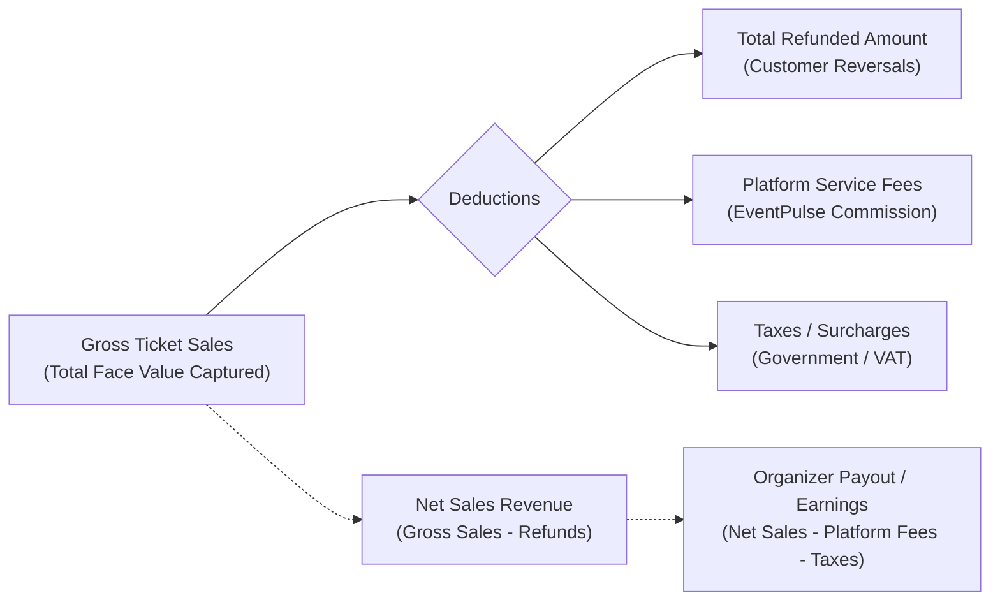
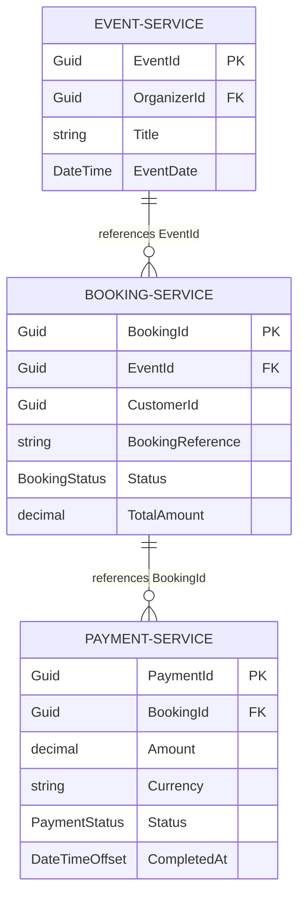

# EventPulse Sales Analytics Specification

**Document Reference:** `EP-382`  
**Parent Epic / Feature:** `EP-60` / `US-40` — Sales Analytics  
**Target Services:** Payment Service, Booking Service, Event Service, API Gateway  
**Audience:** Software Engineers, QA Automation & Test Engineers, Product Owners, Business Analysts  
**Status:** Defined Baseline & Sales Analytics Metrics Specification (Awaiting Product Owner Approvals)  

---

## 1. Overview and Objectives

This specification defines the formal business rules, mathematical calculation formulas, cross-service data ownership boundaries, financial reconciliation logic, and architectural patterns governing **Sales Analytics** across the EventPulse platform.

In EventPulse, event creation, ticketing, reservations, and monetary transactions are decoupled across separate microservices:
- **Event Service (`eventpulse_ev`):** Governs event scheduling, organizer ownership (`OrganizerId`), ticket type definitions (`TicketType`), capacity thresholds, and inventory restoration.
- **Booking Service (`eventpulse_bk`):** Governs customer reservations, multi-item line orders (`BookingItem`), individual ticket codes (`Ticket`), and cancellation lifecycle states (`BookingStatus`).
- **Payment Service (`eventpulse_pm`):** Governs Stripe checkout sessions, captured transactions (`Payment`), monetary values, currencies, and refund entries (`RefundRecord`).
- **Apache Kafka:** Facilitates asynchronous domain event choreography (`payment-succeeded`, `payment-failed`, `booking-cancelled`, `booking-refund-requested`, `payment-refunded`).

The primary objectives of this document are to:
1. Establish unambiguous, approved definitions for core sales metrics (gross revenue, net revenue, tickets sold, refunds, and order counts).
2. Clarify financial distinctions between **gross ticket sales**, **platform commissions/fees**, **taxes**, and **organizer net earnings**.
3. Detail how payment states (pending, failed, partially refunded, fully refunded) and booking cancellations affect analytics.
4. Establish cross-service data ownership without violating microservice boundaries (avoiding distributed database joins).
5. Provide developer- and QA-verifiable formulas, decision tables, concrete walkthrough scenarios, and documented unresolved Product Owner decisions.

---

## 2. Baseline Architecture & Codebase Inspection Findings

An exhaustive inspection of the EventPulse codebase was conducted to establish current capabilities and identify reporting boundaries:

### 2.1 Entity & Schema Inspection

| Microservice | Entity / Model | Relevant Attributes | Current Analytics Role |
| :--- | :--- | :--- | :--- |
| **Payment Service** (`eventpulse_pm`) | `Payment` | `Id`, `BookingId`, `BookingReference`, `CustomerId`, `Amount`, `Currency`, `Status`, `CreatedAt`, `CompletedAt` | Source of truth for monetary transactions and captured funds. |
| | `PaymentStatus` | `Pending (0)`, `Succeeded (1)`, `Failed (2)`, `Refunded (3)`, `PartiallyRefunded (4)`, `RefundFailed (5)` | Distinguishes captured funds from abandoned checkouts and reversals. |
| | `RefundRecord` | `Id`, `PaymentId`, `BookingId`, `Amount`, `Currency`, `Status`, `Reason`, `CreatedAt`, `CompletedAt` | Source of truth for individual refund deductions. |
| | `RefundStatus` | `Pending (0)`, `Completed (1)`, `Failed (2)`, `NotRefundable (3)` | Distinguishes completed refunds from pending or failed attempts. |
| **Booking Service** (`eventpulse_bk`) | `Booking` | `Id`, `BookingReference`, `CustomerId`, `EventId`, `Status`, `TotalAmount`, `CreatedAt`, `ConfirmedAt`, `CancelledAt` | Source of truth for booking orders and customer linkage to `EventId`. |
| | `BookingItem` | `Id`, `BookingId`, `TicketTypeId`, `TicketName`, `Quantity`, `UnitPrice`, `Subtotal` | Source of truth for ticket type line-item breakdowns and quantities. |
| | `BookingStatus` | `PendingPayment (1)`, `Confirmed (2)`, `PaymentFailed (3)`, `Cancelled (4)` | Authoritative order lifecycle status. |
| | `Ticket` | `Id`, `BookingId`, `BookingItemId`, `TicketTypeId`, `TicketCode`, `Status (Valid, Used, Cancelled)`, `Price` | Authoritative individual ticket status (e.g., gate attendance). |
| **Event Service** (`eventpulse_ev`) | `Event` | `Id`, `OrganizerId`, `Title`, `EventDate`, `Price`, `Status` | Source of truth for event ownership (`OrganizerId`) and scheduling. |
| | `TicketType` | `Id`, `EventId`, `Name`, `Price`, `Capacity`, `BookedQuantity`, `TotalQuantity`, `SoldQuantity`, `RemainingQuantity` | Authoritative inventory capacity and current live ticket counts. |

### 2.2 Kafka Event Contracts

The platform currently publishes the following asynchronous events relevant to sales reporting:
1. `PaymentSucceededEvent` (`topic: payment-succeeded`): Emitted by Payment Service when Stripe confirms payment capture. Contains `PaymentId`, `BookingId`, `BookingReference`, `CustomerId`, `Amount`, `Currency`, and `OccurredAtUtc`.
2. `PaymentRefundedEvent` (`topic: payment-refunded`): Emitted by Payment Service when Stripe confirms a refund. Contains `RefundId`, `PaymentId`, `BookingId`, `Amount`, `Status`, and `RefundedAt`.
3. `BookingCancelledIntegrationEvent` (`topic: booking-cancelled`): Emitted by Booking Service upon booking cancellation. Contains `BookingId`, `EventId`, `ReleasedTickets`, `CancelledAt`, and `Items` (with `TicketTypeId`, `Quantity`, `UnitPrice`, `Subtotal`).
4. `BookingRefundRequestedEvent` (`topic: booking-refund-requested`): Emitted by Booking Service to trigger refunds in Payment Service. Contains `BookingId`, `EventId`, `RefundAmount`, `Reason`, and `RequestedAt`.

### 2.3 Identified Gaps & Findings
1. **No Dedicated Sales Reporting Store:** No existing table or service currently pre-aggregates sales metrics by Organizer, Event, or Ticket Type.
2. **Missing Organizer Link in Payments:** The `Payment` entity in Payment Service stores `BookingId` and `CustomerId`, but does **not** store `EventId` or `OrganizerId`.
3. **Missing Ticket Type Breakdown in Payments:** The `Payment` entity stores only the aggregate `Amount`, not the line-item breakdown across multiple `TicketType`s. Line items exist exclusively in Booking Service (`BookingItem`).
4. **Decoupled Event Ownership:** The relationship between an `EventId` and its `OrganizerId` exists solely within Event Service (`Event.OrganizerId`).
5. **Currency Convention:** While Stripe payments default to `"lkr"` in checkout controller execution, the model fallback is `"usd"`. Multi-currency normalization is not yet implemented.

---

## 3. Core Sales Metrics Definitions & Semantic Distinctions

To ensure financial accuracy, the platform strictly separates gross sales, fees, taxes, and net organizer earnings. These terms must **never** be used interchangeably.



### 3.1 Financial Terminology

1. **Gross Ticket Sales (Gross Revenue):**  
   The total face-value monetary amount captured from ticket buyers for confirmed bookings prior to any deductions, cancellations, refunds, discounts, or processing fees.
2. **Platform Fees (EventPulse Commission):**  
   The platform surcharge or percentage commission retained by EventPulse for hosting and processing ticket sales.  
   *(Note: As of Sprint 4 baseline, platform commission modeling is documented as an open Product Owner decision; all ticket prices currently represent the gross ticket price).*
3. **Taxes / VAT:**  
   Statutory sales tax or value-added tax levied by government authorities. *(Not currently itemized separately in baseline schemas).*
4. **Total Refunded Amount:**  
   The cumulative monetary amount returned to customers via Stripe due to full or partial booking cancellations.
5. **Net Sales Revenue:**  
   Gross Ticket Sales minus Total Completed Refunds. Represents the total active sales retained by the platform for the event.
6. **Organizer Net Earnings:**  
   Net Sales Revenue minus Platform Service Fees and applicable transaction processing fees. Represents the final payout eligible for transfer to the organizer.

---

### 3.2 Proposed Core Metrics Portfolio

The following 8 metrics constitute the approved sales analytics portfolio for EventPulse:

| Metric Name | Short Code | Semantic Definition | Financial Scope | Owning Aggregation Level |
| :--- | :--- | :--- | :--- | :--- |
| **Total Gross Revenue** | $R_{\text{gross}}$ | Sum of total captured transaction amounts for all confirmed bookings. | Gross ticket sales | Platform, Organizer, Event |
| **Total Tickets Sold (Gross)** | $Q_{\text{gross}}$ | Total quantity of tickets issued across all confirmed purchases. | Units issued | Platform, Organizer, Event, Ticket Type |
| **Total Active Tickets (Net)** | $Q_{\text{net}}$ | Total quantity of valid, active tickets currently in customer possession ($Q_{\text{gross}} - Q_{\text{cancelled}}$). | Active inventory | Platform, Organizer, Event, Ticket Type |
| **Revenue per Event** | $R_{\text{event}}$ | Total gross revenue generated specifically by a designated event. | Gross ticket sales | Event |
| **Revenue per Ticket Type** | $R_{\text{tier}}$ | Total gross revenue generated by a specific ticket tier within an event. | Gross ticket sales | Ticket Type |
| **Total Refunded Amount** | $R_{\text{refund}}$ | Sum of all completed refunds executed for the event or organizer. | Deductions / Reversals | Platform, Organizer, Event |
| **Net Revenue** | $R_{\text{net}}$ | Total Gross Revenue minus Total Refunded Amount ($R_{\text{gross}} - R_{\text{refund}}$). | Net retained sales | Platform, Organizer, Event |
| **Number of Successful Purchases** | $N_{\text{tx}}$ | Distinct count of successful booking orders confirmed. | Order count | Platform, Organizer, Event |
| **Event-Level Sales Summary** | $S_{\text{event}}$ | Comprehensive performance matrix (capacity utilization, AOV, refund rate). | Executive summary | Event |

---

## 4. Mathematical Formulas & Calculation Rules

### 4.1 Canonical Formulas

Let:
- $\mathcal{B}_{\text{confirmed}}$ be the set of bookings associated with the event/organizer where a captured payment was confirmed (`BookingStatus.Confirmed` or previously confirmed prior to cancellation).
- $\mathcal{I}_b$ be the set of `BookingItem` line items belonging to booking $b \in \mathcal{B}_{\text{confirmed}}$.
- $\mathcal{R}_{\text{completed}}$ be the set of `RefundRecord` entries where `Status == RefundStatus.Completed`.
- $\mathcal{T}_{\text{cancelled}}$ be the set of tickets where `Status == TicketStatus.Cancelled`.

#### 1. Total Gross Revenue ($R_{\text{gross}}$)
$$R_{\text{gross}} = \sum_{b \in \mathcal{B}_{\text{confirmed}}} \text{TotalAmount}_b = \sum_{b \in \mathcal{B}_{\text{confirmed}}} \sum_{i \in \mathcal{I}_b} (\text{Quantity}_i \times \text{UnitPrice}_i)$$

#### 2. Total Refunded Amount ($R_{\text{refund}}$)
$$R_{\text{refund}} = \sum_{r \in \mathcal{R}_{\text{completed}}} \text{Amount}_r$$

#### 3. Net Revenue ($R_{\text{net}}$)
$$R_{\text{net}} = R_{\text{gross}} - R_{\text{refund}}$$

#### 4. Gross Tickets Sold ($Q_{\text{gross}}$)
$$Q_{\text{gross}} = \sum_{b \in \mathcal{B}_{\text{confirmed}}} \sum_{i \in \mathcal{I}_b} \text{Quantity}_i$$

#### 5. Net Active Tickets Sold ($Q_{\text{net}}$)
$$Q_{\text{net}} = Q_{\text{gross}} - |\mathcal{T}_{\text{cancelled}}|$$

#### 6. Revenue per Ticket Type ($R_{\text{tier}}(t)$)
For a specific `TicketTypeId` $t$:
$$R_{\text{gross, tier}}(t) = \sum_{b \in \mathcal{B}_{\text{confirmed}}} \sum_{\substack{i \in \mathcal{I}_b \\ i.\text{TicketTypeId} = t}} (\text{Quantity}_i \times \text{UnitPrice}_i)$$
$$R_{\text{net, tier}}(t) = R_{\text{gross, tier}}(t) - R_{\text{refund, tier}}(t)$$

#### 7. Number of Successful Purchases ($N_{\text{tx}}$)
$$N_{\text{tx}} = |\mathcal{B}_{\text{confirmed}}|$$

#### 8. Average Order Value (AOV)
$$\text{AOV} = \begin{cases} \frac{R_{\text{gross}}}{N_{\text{tx}}}, & \text{if } N_{\text{tx}} > 0 \\ 0.00, & \text{otherwise} \end{cases}$$

#### 9. Capacity Utilization Rate (CUR)
For an event $e$ with ticket tiers $\mathcal{K}_e$:
$$\text{CUR}_e = \frac{Q_{\text{net}, e}}{\sum_{k \in \mathcal{K}_e} \text{Capacity}_k} \times 100\%$$

#### 10. Refund Rate (RR)
$$\text{RR}_e = \begin{cases} \frac{R_{\text{refund}, e}}{R_{\text{gross}, e}} \times 100\%, & \text{if } R_{\text{gross}, e} > 0 \\ 0.00\%, & \text{otherwise} \end{cases}$$

---

### 4.2 Calculation & Invariant Decision Rules

#### Rule 1: Payment Status Inclusions and Exclusions
- **Included Payments:** Only payments in `PaymentStatus.Succeeded`, `PaymentStatus.PartiallyRefunded`, or `PaymentStatus.Refunded` are eligible for revenue calculation.
- **Excluded Payments:** 
  - `PaymentStatus.Pending` (in-flight checkout sessions or abandoned cart holds) $\rightarrow$ **EXCLUDED**. Must not appear in gross or net sales.
  - `PaymentStatus.Failed` (declined cards, expired Stripe sessions) $\rightarrow$ **EXCLUDED**.
  - `PaymentStatus.RefundFailed` $\rightarrow$ Evaluated as active revenue (since funds remain captured) until a retry succeeds.
- **Booking Status Filter:** Bookings in `BookingStatus.PendingPayment` or `BookingStatus.PaymentFailed` are strictly excluded from all sales metrics.

#### Rule 2: Treatment of Cancellations & Refunds
- **Gross Revenue Preservation:** Under standard accrual accounting, cancelling a booking does **NOT** reduce historical Gross Revenue ($R_{\text{gross}}$). The initial economic transaction occurred and was captured.
- **Net Revenue Adjustment:** The refund amount ($R_{\text{refund}}$) is tracked in the refund ledger and deducted strictly from Net Revenue ($R_{\text{net}}$).
- **Ticket Counts Distinction:**
  - $Q_{\text{gross}}$ retains the count of all tickets originally purchased.
  - $Q_{\text{net}}$ decrements by the quantity of cancelled tickets, reflecting the current active attendee count.
- **Non-Refundable / Zero-Refund Cancellations:**  
  When an eligible customer cancels within a non-refundable cutoff window ($\Delta t \le T_{\text{non-ref}}$) resulting in a $0 refund ($R_{\text{refund}} = 0.00$):
  - $R_{\text{gross}}$ remains unchanged.
  - $R_{\text{net}}$ remains unchanged (the organizer retains 100% of the funds).
  - $Q_{\text{net}}$ decreases by the ticket quantity (the seat is released/forfeited).

#### Rule 3: Allocation Across Multiple Ticket Types
When a booking contains multiple ticket types (e.g., 2 VIP tickets @ $100 and 3 General Admission tickets @ $40 = Total $320):
1. **Gross Allocation:** Line item gross revenue is computed strictly from `BookingItem.Quantity * BookingItem.UnitPrice`. VIP gross is $200; General gross is $120.
2. **Single Ticket Cancellation Allocation:** If 1 VIP ticket is cancelled with a $100 refund:
   - VIP gross remains $200; VIP refund = $100; VIP net = $100. VIP net tickets = 1.
   - General metrics remain completely unaffected (Gross $120, Net $120, Net tickets = 3).
3. **Proportional Refund Allocation (Tiered Cutoff):** If the whole booking is cancelled with a 50% partial refund tier ($160 total refund):
   - Refunds are allocated proportionally to line item subtotal weights:
     $$R_{\text{refund, tier}} = R_{\text{refund, total}} \times \left(\frac{\text{Subtotal}_{\text{tier}}}{\text{TotalAmount}}\right)$$
   - VIP refund = $160 \times (200 / 320) = \$100.00$.
   - General refund = $160 \times (120 / 320) = \$60.00$.

#### Rule 4: Deduplication of Multiple Payment Attempts
- A customer may experience multiple failed or abandoned Stripe checkout sessions for a single booking before achieving a successful payment.
- In Payment Service, this creates multiple `Payment` records for the same `BookingId` (one or more `Failed` or `Pending` rows, and exactly one `Succeeded` row).
- **Deduplication Rule:** Analytics aggregation MUST group strictly by `BookingId` or evaluate only `Payment` records matching:
  $$\text{Status} \in \{\text{Succeeded}, \text{PartiallyRefunded}, \text{Refunded}\}$$
- The count of successful purchases ($N_{\text{tx}}$) counts the unique `BookingId`, guaranteeing that prior failed attempts never inflate purchase counts.

#### Rule 5: Multi-Currency Reporting Rules
- EventPulse operates primarily in Sri Lankan Rupees (`LKR`), with international credit card processing supporting `USD`.
- **Core Financial Invariant:** Metrics MUST NEVER sum values across differing currencies into a single raw scalar value (e.g., LKR 10,000 + USD 50 must NOT yield 10,050).
- **Reporting Strategy:**
  - **Grouped Currency (Sprint 4 Baseline):** All sales analytics responses MUST partition metrics by ISO 4217 currency code (e.g., `LKR: { gross: 250000, net: 230000 }`, `USD: { gross: 400, net: 400 }`).
  - **Single Platform Base Currency (Future Scope):** If a unified dashboard total is required, an authoritative daily exchange rate service must be integrated. (Documented under PO Unresolved Decisions).

#### Rule 6: Reporting Timestamp & Temporal Filtering
- **Primary Reporting Timestamp:** `Payment.CompletedAtUtc` (or `Booking.ConfirmedAtUtc` as authoritative proxy).  
  Sales metrics are indexed by the moment financial capture succeeded (**Transaction / Cash Basis**).
- **Date Range Boundary Precision:** Date filters (e.g., `from=2026-10-01&to=2026-10-31`) MUST evaluate timestamps in **strict Coordinated Universal Time (UTC)** using inclusive lower bounds and exclusive upper bounds:
  $$\text{TimestampUtc} \ge \text{FromUtc} \quad \text{AND} \quad \text{TimestampUtc} < \text{ToUtc}$$

#### Rule 7: Late-Arriving Refunds Handling
- *Scenario:* A ticket is purchased in October ($100 gross). The customer cancels in November, receiving a $100 refund.
- **Accounting Policy Options:**
  - **Option A (Period Activity / Cash Flow Basis):** October report shows Gross = $100, Refund = $0, Net = $100. November report shows Gross = $0, Refund = $100, Net = -$100. (Reflects actual cash movement per calendar period).
  - **Option B (Accrual / Order Cohort Basis):** The November refund is tied to the original October order cohort. Lifetime net revenue for the October cohort adjusts to $0.
- **Recommended Policy:** Lifetime event reports use Cohort Reconciliation; monthly cash-flow reports use Period Activity. (Marked for PO Confirmation).

---

## 5. Cross-Service Data Ownership & Architecture

### 5.1 Data Ownership Matrix

To preserve loose coupling, services maintain strict ownership of their respective bounded contexts:



| Domain Element | Owning Microservice | Storage Engine | Invariant & Boundary Constraint |
| :--- | :--- | :--- | :--- |
| **Organizer Identity** | Identity Service / Event Service | PostgreSQL (`eventpulse_ev`) | Only Event Service maps `OrganizerId` to `EventId`. Payment Service has zero knowledge of organizers. |
| **Event Metadata & Tiers** | Event Service | PostgreSQL (`eventpulse_ev`) | Authoritative event dates, titles, tier capacities, and ticket prices. |
| **Booking Orders & Items** | Booking Service | PostgreSQL (`eventpulse_bk`) | Authoritative order quantities, ticket tier snapshots at time of purchase, and booking statuses. |
| **Payments & Transactions** | Payment Service | PostgreSQL (`eventpulse_pm`) | Authoritative monetary capture amounts, currency, Stripe references, and timestamps. |
| **Refunds Ledger** | Payment Service | PostgreSQL (`eventpulse_pm`) | Authoritative executed refund records, Stripe refund IDs, and refund statuses. |

---

### 5.2 Microservice Reporting Architecture

> [!WARNING]
> **Strict Microservices Boundary Invariant:**  
> Direct cross-database joins across `eventpulse_ev`, `eventpulse_bk`, and `eventpulse_pm` (e.g., via multi-database SQL queries or foreign data wrappers) are **strictly prohibited**. Doing so violates microservice encapsulation, breaks distributed deployment boundaries, and creates single-point-of-failure bottlenecks.

To satisfy the requirements of EP-60, three architectural options were evaluated:

#### Option 1: Event-Driven CQRS Sales Analytics Read-Model (Recommended)
A dedicated Sales Analytics projection / read-store populated asynchronously by consuming existing Kafka integration events:

```mermaid
flowchart TD
    subgraph Core Microservices
        EV["Event Service"] -- "event-submitted / event-updated" --> K["Apache Kafka"]
        BK["Booking Service"] -- "booking-created / booking-cancelled" --> K
        PM["Payment Service"] -- "payment-succeeded / payment-refunded" --> K
    end
    
    subgraph Analytics Architecture (EP-60)
        K --> C["Sales Analytics Event Consumer"]
        C --> DB[("Sales Analytics Read-Store<br/>(PostgreSQL Materialized View / Projections)")]
        DB --> API["Sales Analytics Query API<br/>GET /api/organizer/analytics/sales"]
    end
    
    API --> GW["YARP API Gateway"] --> FE["Organizer Frontend Dashboard"]
```

- **Mechanism:**  
  1. Consumer listens to `payment-succeeded`, `payment-refunded`, `booking-cancelled`, and `event-published`.  
  2. Updates a denormalized read-model table: `OrganizerSalesProjections` & `EventSalesProjections`.  
- **Advantages:** Sub-millisecond response times, zero runtime load on transactional checkout databases, highly resilient against microservice outages.
- **Trade-off:** Eventual consistency (typically < 500ms lag).

#### Option 2: API Gateway / BFF Dynamic Composition
The API Gateway or an aggregation endpoint queries Event Service, Booking Service, and Payment Service synchronously in parallel via REST and joins results in memory.
- **Trade-off:** High latency (fan-out query), fragile (fails if any of the 3 services is down), high resource consumption during dashboard traffic spikes.

#### Option 3: Synchronous Service-to-Service REST Aggregation
Booking Service or Payment Service acts as an internal orchestrator, making downstream HTTP calls to assemble analytics on demand.
- **Trade-off:** Introduces tight synchronous coupling between services, violates single-responsibility principle.

**Architectural Recommendation:** **Option 1 (CQRS Read-Store via Kafka Events)** is the target enterprise pattern for EventPulse. For initial Sprint 4 deliverables (EP-383), an aggregation read-model approach within the service boundary or a lightweight reporting projection will be implemented.

---

## 6. Event Ownership & Authorization Security Rules

1. **Organizer Tenancy Isolation:**  
   - Organizers can **only** query analytics for events where `Event.OrganizerId == CallerUserId`.
   - Any attempt by Organizer $A$ to request analytics for an event belonging to Organizer $B$ MUST return `403 Forbidden` (or `404 Not Found` to prevent event ID enumeration).
2. **Administrator Platform Access:**  
   - Platform Administrators possessing the `AdminOnly` authorization policy are authorized to view platform-wide aggregated sales metrics across all events and organizers.
3. **Customer Access Restriction:**  
   - Standard customers are strictly unauthorized to view sales analytics endpoints (`403 Forbidden`).
4. **Token Claim Verification:**  
   - The caller's `sub` / `nameid` claim in the validated JWT bearer token is extracted by the gateway/controller to enforce organizer tenancy.

---

## 7. Concrete Calculation Examples (Developers & QA Test Cases)

The following test scenarios establish expected mathematical outputs for developer automated tests and QA validation:

### Scenario 1: Standard Multi-Item Booking (Happy Path)
- **Event:** *Tech Summit 2026* (Event ID: `evt-01`, Currency: `LKR`)
- **Booking 1:** 2 VIP Tickets @ LKR 10,000 = LKR 20,000. Confirmed.
- **Booking 2:** 3 General Tickets @ LKR 4,000 = LKR 12,000. Confirmed.
- **Total Capacity:** 100 tickets.

**Expected Metrics:**
- **Total Gross Revenue ($R_{\text{gross}}$):** $\text{LKR } 32,000.00$
- **Total Refunded Amount ($R_{\text{refund}}$):** $\text{LKR } 0.00$
- **Net Revenue ($R_{\text{net}}$):** $\text{LKR } 32,000.00$
- **Gross Tickets Sold ($Q_{\text{gross}}$):** $5$
- **Net Active Tickets ($Q_{\text{net}}$):** $5$
- **Number of Successful Purchases ($N_{\text{tx}}$):** $2$
- **Average Order Value (AOV):** $\text{LKR } 16,000.00$
- **Revenue by Tier:**
  - VIP: Gross LKR 20,000 / Net LKR 20,000 (2 tickets sold)
  - General: Gross LKR 12,000 / Net LKR 12,000 (3 tickets sold)
- **Capacity Utilization:** $5 / 100 = 5.00\%$

---

### Scenario 2: Partial Single Ticket Cancellation
- **Event:** *Indie Music Night* (Event ID: `evt-02`, Currency: `LKR`)
- **Booking 1:** 1 VIP Ticket @ LKR 8,000 + 2 Standard Tickets @ LKR 3,000 = Total LKR 14,000. Confirmed.
- **Action:** 10 days before event, customer cancels 1 Standard Ticket (eligible for 100% unit refund).
- **Refund Processed:** LKR 3,000 refunded via Stripe.

**Expected Metrics:**
- **Total Gross Revenue ($R_{\text{gross}}$):** $\text{LKR } 14,000.00$ (Gross captured sales preserved)
- **Total Refunded Amount ($R_{\text{refund}}$):** $\text{LKR } 3,000.00$
- **Net Revenue ($R_{\text{net}}$):** $\text{LKR } 11,000.00$
- **Gross Tickets Sold ($Q_{\text{gross}}$):** $3$
- **Net Active Tickets ($Q_{\text{net}}$):** $2$
- **Number of Successful Purchases ($N_{\text{tx}}$):** $1$
- **Revenue by Tier:**
  - VIP: Gross LKR 8,000 / Net LKR 8,000 (1 net ticket)
  - Standard: Gross LKR 6,000 / Refund LKR 3,000 / Net LKR 3,000 (1 net ticket)
- **Refund Rate:** $(3,000 / 14,000) \times 100\% = 21.43\%$

---

### Scenario 3: Non-Refundable Late Cancellation (Retained Revenue)
- **Event:** *Gala Dinner* (Event ID: `evt-03`, Currency: `LKR`)
- **Booking 1:** 2 Tickets @ LKR 15,000 = LKR 30,000. Confirmed.
- **Action:** Customer cancels 6 hours prior to start (within non-refundable cutoff $< 24\text{h}$). Policy dictates $0.00$ refund. Seat capacity is released, but funds are retained.

**Expected Metrics:**
- **Total Gross Revenue ($R_{\text{gross}}$):** $\text{LKR } 30,000.00$
- **Total Refunded Amount ($R_{\text{refund}}$):** $\text{LKR } 0.00$
- **Net Revenue ($R_{\text{net}}$):** $\text{LKR } 30,000.00$
- **Gross Tickets Sold ($Q_{\text{gross}}$):** $2$
- **Net Active Tickets ($Q_{\text{net}}$):** $0$ (Tickets invalidated)
- **Refund Rate:** $0.00\%$

---

### Scenario 4: Deduplication of Payment Attempts
- **Customer:** Initiates booking for LKR 5,000.
  - Attempt 1: Payment fails (insufficient funds) $\rightarrow$ `PaymentStatus.Failed`.
  - Attempt 2: Payment abandoned (user closes browser) $\rightarrow$ `PaymentStatus.Pending`.
  - Attempt 3: Payment succeeds with new card $\rightarrow$ `PaymentStatus.Succeeded`.

**Expected Metrics:**
- **Gross Revenue Contribution:** $\text{LKR } 5,000.00$ (NOT LKR 15,000)
- **Successful Purchases ($N_{\text{tx}}$):** $1$ (NOT 3)
- Failed and pending rows contribute $0$ to sales analytics.

---

## 8. Summary of Unresolved Decisions (Pending Product Owner Confirmation)

The following parameters are documented as open decisions requiring Product Owner sign-off prior to backend and frontend implementation in EP-383 and EP-384:

| Decision ID | Topic | Options / Proposed Default | Impacted Scope | Status |
| :--- | :--- | :--- | :--- | :--- |
| **PO-SA-01** | **Primary Accounting Basis** | **Proposed:** Transaction / Cash Basis (`Payment.CompletedAtUtc`).<br>*Alternative:* Accrual / Event Date Basis (`Event.EventDate`). | Backend aggregation queries | **PENDING PO APPROVAL** |
| **PO-SA-02** | **Late Refund Treatment** | **Proposed:** Lifetime cohort deduction for event summaries; period-activity for calendar monthly cash-flow reports. | Monthly sales reporting | **PENDING PO APPROVAL** |
| **PO-SA-03** | **Platform Commission / Fees** | **Proposed:** Gross ticket sales represent 100% organizer revenue in Sprint 4; platform commission deductions deferred to Sprint 5. | Revenue definitions | **PENDING PO APPROVAL** |
| **PO-SA-04** | **Multi-Currency Aggregation** | **Proposed:** Strict currency grouping (partition by currency code). Disallow cross-currency summation. | DTO structure | **PENDING PO APPROVAL** |
| **PO-SA-05** | **Default Analytics Date Windows** | **Proposed:** Lifetime event aggregate, with presets for Last 7 Days, Last 30 Days, This Month, and Custom Date Range. | Frontend dashboard & API filters | **PENDING PO APPROVAL** |
| **PO-SA-06** | **Cancelled Booking Ticket Metric** | **Proposed:** Display both **Gross Tickets Sold** (historical volume) and **Net Active Tickets** (current valid attendees) on the event summary. | Dashboard UX | **PENDING PO APPROVAL** |

---

## 9. Implementation Roadmap & Dependencies for EP-383

Upon sign-off of EP-382, backend implementation proceeds under **EP-383 (Sales analytics: aggregate sales data backend)** with the following dependencies:

1. **API Endpoints (EP-383):**
   - `GET /api/organizer/analytics/sales/overview`: Lifetime and date-filtered gross revenue, net revenue, tickets sold, and refunds for authenticated organizer.
   - `GET /api/organizer/analytics/sales/events/{eventId}`: Event-level granular sales breakdown including ticket tiers, AOV, and refund rate.
   - `GET /api/admin/analytics/sales`: Platform-wide sales aggregates for administrators.
2. **Data Aggregation Strategy:**
   - Establish service endpoint in `BookingService` or dedicated reporting controller with cross-service event correlation.
   - Apply strict `OrganizerId` JWT authorization filter.
3. **Frontend Presentation (EP-384 / EP-385):**
   - Organizer Dashboard sales charts, KPI cards, and breakdown tables.
